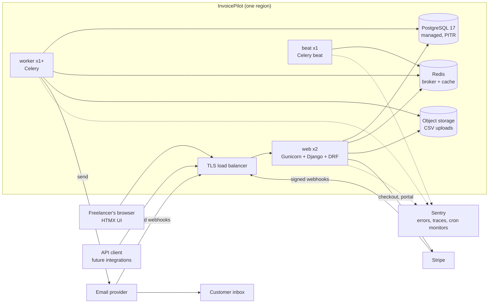
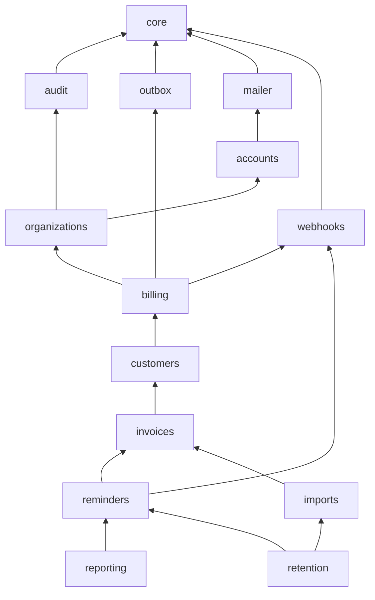
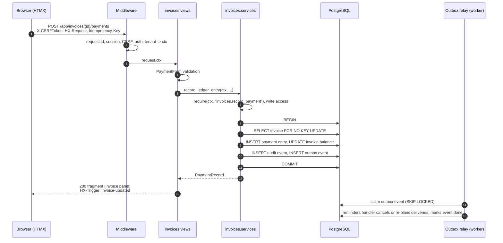
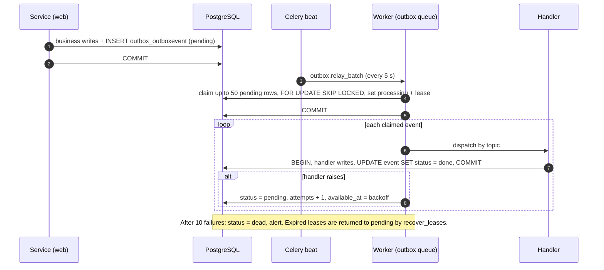

# InvoicePilot: System Design

**Version:** 1.0 · **Date:** 2026-10-20 · **Status:** Ready for implementation

**Related documents:** [Database design](../design/phase-2.1-database-design.md) · [API contracts](../api/api-contracts.md) · [Threat model](../security/threat-model.md)

This document describes how the application is built around the database: which module owns what, how a request flows through the system, where transactions begin and end, how background work runs, and how the system is deployed, monitored and recovered after a failure. The database design is the contract for data. This document is the contract for code.

---

## 1. Summary

- **One Django codebase, deployed as three process types:** `web` (Gunicorn), `worker` (Celery) and `beat` (Celery beat, exactly one instance).
- **PostgreSQL is the only source of truth.** Redis is the Celery broker and a cache, and holds nothing that can't be rebuilt from PostgreSQL. If Redis is flushed, the sweepers in §9 recreate any lost work.
- **Eleven feature modules plus infrastructure.** Each owns its tables and exposes write operations only through its `services.py`. Dependencies point one way, and an import linter enforces it.
- **Server-rendered UI with HTMX.** It uses Django templates and returns HTML fragments, with no single-page app and no separate frontend build. A versioned JSON API (Django REST Framework) exposes the same services for integrations.
- **Every side effect is durable before it happens.** Follow-up work goes through the outbox. Reminders go through the delivery table. Webhooks go through the inbox table. Nothing important depends on a Celery message surviving.

**Dependencies to add** (pinned in `uv.lock`): `djangorestframework`, `drf-spectacular`, `celery[redis]`, `django-redis`, `stripe`, `whitenoise`, `gunicorn`, `argon2-cffi`, `django-csp`, `sentry-sdk`, `django-prometheus`, `django-storages[s3]`. Dev: `import-linter`, `pip-audit`, `ruff`. HTMX 2.0.x is vendored into `static/`, not loaded from a CDN.

## 2. System context and deployment topology



| Component | MVP sizing | Notes |
|---|---|---|
| `web` | 2 instances, 1 vCPU / 1 GB each | `gunicorn config.wsgi --workers 3 --threads 2 --timeout 30 --max-requests 1000 --max-requests-jitter 100`. Two instances, so a deploy or crash never takes the site down. |
| `worker` | 1 instance, `--concurrency 4` | Consumes every queue (§8.2). Split into per-queue workers when one queue starves the others. |
| `beat` | Exactly 1 instance | Two beats would double every schedule. The platform must guarantee a single replica. Every beat job is idempotent anyway. |
| PostgreSQL 17 | Managed, 2 vCPU / 4 GB, point-in-time recovery (PITR) with at least 7 days of history | High availability (a standby) is optional at launch and required once paying customers depend on it. Private network only. |
| Redis 7 | Managed, 256 MB to 1 GB, password + TLS | Private network only. Persistence is optional: the design survives a flush. |
| Object storage | S3-compatible bucket, private, server-side encryption | Lifecycle rule deletes objects after 35 days, a backstop for the 30-day retention job. |
| Email provider | Transactional API with signed webhooks | Sending domain `mail.invoicepilot.app` with SPF, DKIM and DMARC (`p=quarantine` at launch). |
| Stripe | Checkout, Billing portal, webhooks | Restricted API key (§12.3). |

The design works on any container platform that offers these managed services. Nothing depends on a particular vendor.

**Environments:** `local` (Docker Compose: Postgres, Redis, MinIO, Mailpit; Stripe CLI for webhooks), `staging` (Stripe test mode, an email sandbox, production-shaped infrastructure at the smallest size) and `production`.

## 3. Module ownership

### 3.1 Modules

Every table has exactly one owning module. Only that module's `services.py` writes to the table.

| Module | Owns tables | Responsibility | Key services |
|---|---|---|---|
| `core` | none | Base models, UUIDv7, `TenantQuerySet`, validators, `RequestContext`, domain errors, problem-JSON handler, request-ID and logging setup | (none) |
| `accounts` | `accounts_user` | Sign-up, login, email verification, password reset and change | `register_user`, `verify_email`, `request_password_reset`, `reset_password`, `change_password` |
| `organizations` | `organizations_organization`, `organizations_membership` | Workspaces, membership, tenant resolution, the role and permission map | `create_workspace`, `update_workspace`, `select_workspace` |
| `billing` | `billing_plan`, `billing_subscription` | Stripe Checkout and portal, subscription mirror, write access, plan limits | `start_checkout`, `open_billing_portal`, `apply_stripe_event`, `sync_workspace_access`, `check_plan_limit` |
| `customers` | `customers_customer` | Customer records | `create_customer`, `update_customer`, `deactivate_customer`, `reactivate_customer`, `delete_customer` |
| `invoices` | `invoices_invoice`, `invoices_paymentrecord` | Invoices, the payment ledger, balance and status | `create_invoice`, `update_invoice`, `void_invoice`, `mark_disputed`, `resolve_dispute`, `pause_reminders`, `resume_reminders`, `record_ledger_entry`, `reverse_ledger_entry` |
| `reminders` | `reminders_*` (7 tables) | Policies, steps, templates, sender identities, suppressions, delivery planning, sending, reconciliation | `update_policy`, `save_step`, `save_template`, `add_sender_identity`, `confirm_sender`, `add_suppression`, `lift_suppression`, `plan_invoice`, `claim_due_deliveries`, `send_delivery`, `reconcile_delivery`, `render_preview` |
| `imports` | `imports_importbatch`, `imports_importrow` | CSV upload, validation, preview, commit | `upload_batch`, `validate_batch`, `commit_batch`, `cancel_batch` |
| `reporting` | none | Read-only: dashboard, aging, CSV exports | `dashboard_summary`, `aging_report`, `export_invoices_csv`, `export_ledger_csv` |
| `audit` | `audit_auditevent` | The append-only audit log | `record` |
| `outbox` | `outbox_outboxevent` | Emit, relay, handler registry | `emit`, `relay_batch`, `recover_leases` |
| `webhooks` | `webhooks_webhookevent` | Signature verification, inbox, dispatch to registered handlers | `receive`, `process_event` |
| `mailer` | none | Email provider adapter: send with an idempotency key, look up a message, parse provider webhooks. Also used for account emails. | `send`, `lookup` |
| `retention` | none | Retention purges | `run` |

`mailer` and `reporting` are new modules. `outbox` is the new app from the database design.

### 3.2 Layout of a module

```
invoicepilot/<module>/
  models.py         tables, constraints, small pure methods (derive_status)
  services.py       write use cases; the only place a transaction starts
  selectors.py      tenant-scoped reads, returning querysets or values
  permissions.py    the action names this module checks
  handlers.py       outbox and webhook consumers, registered at app ready()
  tasks.py          Celery entry points; thin, they call services
  views.py          HTMX pages and fragments; thin, they call services and selectors
  forms.py          Django forms for the HTML views
  api/              serializers.py, views.py, urls.py (DRF)
  templates/<module>/
```

### 3.3 Dependency rules



Arrows point from a module to what it may import, transitively. Rules, enforced by `import-linter` contracts in `pyproject.toml` and run in CI:

1. **No upward imports.** For example, `invoices` never imports `reminders`. When `invoices` needs something to happen in `reminders`, it emits an outbox event (`invoice.balance_changed`) and `reminders.handlers` consumes it.
2. **Inversion through registries.** `webhooks` and `outbox` don't import their consumers. `billing` and `reminders` register handlers in their `AppConfig.ready()`.
3. **Writes go through the owning module's services.** A module may import another module's models for foreign keys, type hints and read-only queries inside its own `selectors.py`. It never calls `.save()`, `.update()`, `.delete()` or `bulk_*` on another module's model.
4. **Views and API views stay thin.** They import their own module's `forms`, `api.serializers`, `services` and `selectors`, plus `core`. They never import any module's `models` to write.
5. **Tasks take IDs, not objects.** Every Celery task signature is primitive (UUID strings) and reloads state from the database.

## 4. Service layer contract

```python
@dataclass(frozen=True)
class RequestContext:              # core.context
    actor_type: str                # "user" | "worker" | "webhook" | "system" | "admin"
    user: User | None
    organization: Organization | None
    membership: Membership | None
    request_id: str
    source: str                    # "web" | "api" | "task" | "webhook" | "command"

def record_ledger_entry(*, ctx: RequestContext, invoice_id: UUID, kind: str, amount: Decimal,
                        received_on: date, method: str = "", reference: str = "", note: str = "",
                        idempotency_key: str | None = None) -> PaymentRecord: ...
```

- **Keyword-only arguments, with `ctx` first.** The workspace always comes from `ctx.organization`, never from an argument the caller controls.
- **Authorization happens inside the service.** It calls `organizations.permissions.require(ctx, "invoices.record_payment")`. Views check too, for a better message, but the service check is the one that counts, because tasks, commands and API views all reach the service.
- **Services raise domain errors** from `core.errors`. Views and the API map them to responses:

| Error | HTML (HTMX) | API |
|---|---|---|
| `ValidationError` | 422 with the form re-rendered | 400 `validation_error` |
| `NotFound` (including another workspace's ID) | 404 page | 404 `not_found` |
| `PermissionDenied` | 403 page | 403 `permission_denied` |
| `ReadOnlyWorkspace` | Banner and link to billing | 403 `workspace_read_only` |
| `PlanLimitReached` | Upgrade prompt | 403 `plan_limit_reached` |
| `EmailNotVerified` | Prompt to verify | 403 `email_not_verified` |
| `InvalidState` (for example, a payment on a void invoice) | 409 with a message | 409 `invalid_state` |
| `VersionConflict` | 409 with a "reload" fragment | 412 `version_conflict` |
| `Duplicate` (invoice number, customer email) | 422, field error | 409 `duplicate` |

- **Selectors** take `ctx` and start from `Model.objects.for_organization(ctx.organization)`. An ID from another workspace is simply not found: the response is 404, never 403, so the response doesn't reveal that the ID exists.
- **Background tasks** build `RequestContext.system(organization=…, task_id=…)` with `actor_type="worker"`.

## 5. Request lifecycle

### 5.1 Middleware stack

| # | Middleware | Purpose |
|---|---|---|
| 1 | `django.middleware.security.SecurityMiddleware` | HTTPS redirect, HSTS, `nosniff`, referrer policy |
| 2 | `whitenoise.middleware.WhiteNoiseMiddleware` | Static files with hashed names and long cache lifetimes |
| 3 | `core.middleware.RequestIdMiddleware` | Accepts a valid `X-Request-ID` or generates one, binds it to the logging context and echoes it in the response |
| 4 | `csp.middleware.CSPMiddleware` | Content-Security-Policy (threat model T3) |
| 5 | `django.contrib.sessions.middleware.SessionMiddleware` | Sessions stored in the database |
| 6 | `django.middleware.common.CommonMiddleware` | |
| 7 | `django.middleware.csrf.CsrfViewMiddleware` | CSRF for every unsafe method. Only the webhook views are exempt. |
| 8 | `django.contrib.auth.middleware.AuthenticationMiddleware` | |
| 9 | `django.contrib.messages.middleware.MessageMiddleware` | |
| 10 | `django.middleware.clickjacking.XFrameOptionsMiddleware` | `DENY` |
| 11 | `organizations.middleware.TenantMiddleware` | Resolves the active workspace and builds `request.ctx` |

**`TenantMiddleware`**, for authenticated requests under `/app/` and `/api/`:

1. Read `active_organization_id` from the session. The API may instead send `X-Workspace-ID`. If neither is set and the user has exactly one membership, use that workspace.
2. Load `Membership.objects.select_related("organization").get(user=request.user, organization_id=…)`. This query runs on every request, so a removed membership takes effect immediately.
3. No membership: the UI redirects to the workspace picker and the API returns 404. A workspace with `is_active = false` returns 403 "workspace suspended".
4. Set `request.ctx` and bind `user_id` and `org_id` to the logging context.

Unauthenticated routes (login, sign-up, unsubscribe, webhooks, health checks) get a context with no user or workspace.

### 5.2 An HTMX write, end to end



**HTMX conventions:**
- `base.html` sets `<body hx-headers='{"X-CSRFToken": "{{ csrf_token }}"}'>` so every HTMX request carries the token.
- `htmx.config`: `selfRequestsOnly = true`, `allowEval = false`, `allowScriptTags = false`, `includeIndicatorStyles = false`, `historyCacheSize = 0` (financial pages are never kept in localStorage). `responseHandling` swaps 422 and 409 responses so form errors render in place.
- Views check `request.htmx` (a small helper that reads the `HX-Request` header). They return a fragment for HTMX requests and the full page otherwise, and set `Vary: HX-Request`.
- After a successful non-HTMX POST, the view redirects (post/redirect/get). After an HTMX POST, it returns the updated fragment and an `HX-Trigger` event so other panels refresh.
- Every form that records money carries a hidden `idempotency_key` (a UUID generated when the form is rendered). Every edit form carries the hidden `version`.

### 5.3 An API request

DRF settings:

```python
REST_FRAMEWORK = {
    "DEFAULT_AUTHENTICATION_CLASSES": ["rest_framework.authentication.SessionAuthentication"],
    "DEFAULT_PERMISSION_CLASSES": ["rest_framework.permissions.IsAuthenticated",
                                   "organizations.api.permissions.IsWorkspaceMember"],
    "DEFAULT_RENDERER_CLASSES": ["rest_framework.renderers.JSONRenderer"],   # no browsable API
    "DEFAULT_PARSER_CLASSES": ["rest_framework.parsers.JSONParser"],         # multipart only on imports
    "DEFAULT_PAGINATION_CLASS": "core.api.pagination.CursorPagination",
    "DEFAULT_THROTTLE_CLASSES": ["core.api.throttling.UserRateThrottle"],
    "EXCEPTION_HANDLER": "core.api.errors.problem_exception_handler",
    "DEFAULT_SCHEMA_CLASS": "drf_spectacular.openapi.AutoSchema",
}
```

Flow: authentication (session, with CSRF enforced on unsafe methods) → `IsWorkspaceMember` (`request.ctx` exists) → throttling → the view's `required_action` permission → serializer validation → service → serializer output. Serializers list their fields explicitly (`fields = [...]`, never `__all__`), and `organization`, `balance_due`, `status` and every other system-owned field are read-only. The [API contracts](../api/api-contracts.md) document defines every endpoint.

**API keys** for third-party integrations are not part of v1. They need an organization-scoped key table with hashed secrets and scopes, which is open decision S1 in §14.

### 5.4 HTML route map

| Area | Routes |
|---|---|
| Public | `/`, `/signup`, `/login`, `/logout`, `/verify-email/<token>`, `/password-reset`, `/reset/<uidb64>/<token>` (Django's view, which moves the token into the session at once), `/u/<token>` (unsubscribe), `/legal/*` |
| App | `/app/` dashboard, `/app/customers/…`, `/app/invoices/…`, `/app/invoices/<id>/payments`, `/app/reminders/…`, `/app/imports/…`, `/app/settings/…`, `/app/billing/…`, `/app/audit` |
| Machine | `/api/v1/…`, `/webhooks/stripe`, `/webhooks/email`, `/healthz`, `/readyz` |
| Staff | Django admin on a separate host name (§12.4) |

## 6. Authorization

**Checks, in order, for every tenant operation:**

1. **Authenticated:** the session is valid and the user `is_active`.
2. **Member:** a `Membership` exists for `(user, workspace)`. This is checked on every request (§5.1).
3. **Workspace active:** `Organization.is_active`.
4. **Role permits the action:** `organizations.permissions.require(ctx, action)`.
5. **Write access**, for actions that change data: `ctx.organization.read_only_since IS NULL` (decision D3). Billing actions, exports and reads are allowed in read-only mode, so a lapsed workspace can resubscribe or take its data out.
6. **Extra preconditions** for specific actions. Enabling automation and sending need a verified user email and a verified sender identity.
7. **Object scoping:** every lookup goes through `for_organization(ctx.organization)`.

**Permission map.** The MVP has one role, but every check is written against a named action, so adding roles later is a change to data, not to code:

```python
ROLE_PERMISSIONS = {
    "owner": {
        "workspace.view", "workspace.update",
        "customers.view", "customers.manage",
        "invoices.view", "invoices.manage", "invoices.record_payment", "invoices.reverse_payment",
        "reminders.view", "reminders.manage", "reminders.enable_automation",
        "imports.manage", "reports.view", "reports.export",
        "billing.view", "billing.manage", "audit.view",
    },
}
```

**Platform staff** never use tenant routes. They use the Django admin (§12.4). Admin views of tenant financial tables are read-only. Opening any tenant record in the admin records an `admin.support_access` audit event with a required justification.

## 7. Transaction boundaries

**Rules:**
- `ATOMIC_REQUESTS = False`. Views never open transactions. The outermost service call opens one with `transaction.atomic()`, and nested service calls join it.
- **No network calls inside a transaction:** Stripe, the email provider and object storage are always called before `BEGIN` or after `COMMIT`.
- **Follow-up work goes through the outbox, never `on_commit`.** `transaction.on_commit` is allowed only for best-effort, non-business work: cache invalidation, or enqueueing a task as a latency shortcut when a sweeper guarantees the work anyway.
- **Lock order** follows database design §11.2.

| Use case | Transaction contents | Before or after the transaction |
|---|---|---|
| `create_workspace` | Organization, owner Membership, default EmailTemplates, ReminderPolicy and steps, pending SenderIdentity, audit event | After: the welcome email through `mailer`. It can be lost without harm. |
| `create_invoice` | Advisory plan-limit lock, Invoice insert, audit event, outbox `invoice.schedule_changed` | (none) |
| `update_invoice` | Lock invoice, compare-and-set on `version`, update, audit (with the changes), outbox `invoice.schedule_changed` if the due date or pause state changed | (none) |
| `record_ledger_entry` / `reverse_ledger_entry` | Database design §8.5: lock invoice, insert entry, recalculate, audit, outbox `invoice.balance_changed` | (none) |
| `upload_batch` | Insert ImportBatch (`uploaded`) | **Before:** stream the file to object storage under a random key. A file whose transaction fails is orphaned and removed by the bucket lifecycle rule. |
| `validate_batch` (task) | Insert ImportRows in chunks of 500, each chunk its own transaction, then set `validated` | **Before:** download and parse |
| `commit_batch` | Tx 1: compare-and-set `validated → committing`. Tx 2: insert customers and invoices, mark rows `imported`, set `committed`, audit, outbox `import.committed`. | If Tx 2 fails, a separate transaction sets the batch to `failed` with the error. |
| `start_checkout` | Tx: save `stripe_customer_id` | **Before:** create the Stripe Customer (idempotency key `org:<id>:customer`) and the Checkout Session (idempotency key `org:<id>:checkout:<plan>:<UTC hour>`) |
| `apply_stripe_event` | Lock the subscription row (or insert it), apply if newer than `stripe_event_created`, `sync_workspace_access`, audit, outbox `subscription.changed`, mark the webhook `processed` | **Before:** retrieve the subscription from the Stripe API for its current state (§10.1) |
| `send_delivery` | Three transactions: reserve, then the provider call outside any transaction, then record (database design §11.4) | The provider call sits between them |
| Outbox handler | The handler's writes **and** marking the outbox event `done`, in one transaction | Handlers with external effects use idempotency keys |
| Webhook receipt | One `INSERT … ON CONFLICT DO NOTHING` | After: `on_commit` enqueues the processing task, and the sweeper (§8.3) is the guarantee |

## 8. Background work

### 8.1 Celery configuration

```python
CELERY_BROKER_URL = env("REDIS_URL")                       # rediss:// with a password
CELERY_TASK_SERIALIZER = CELERY_RESULT_SERIALIZER = "json"
CELERY_ACCEPT_CONTENT = ["json"]                          # never pickle
CELERY_TASK_ACKS_LATE = True                              # redeliver if a worker dies mid-task
CELERY_TASK_REJECT_ON_WORKER_LOST = True
CELERY_WORKER_PREFETCH_MULTIPLIER = 1
CELERY_TASK_IGNORE_RESULT = True                          # no result backend
CELERY_BROKER_TRANSPORT_OPTIONS = {"visibility_timeout": 3600}
CELERY_TASK_TIME_LIMIT = 300
CELERY_TASK_SOFT_TIME_LIMIT = 240
```

- **No long `countdown` or `eta`.** With Redis, a delayed message is redelivered after `visibility_timeout`, which duplicates it. Anything scheduled for later is a database row (`scheduled_for`, `available_at`) that beat picks up when it is due.
- **Every task is idempotent**, because `acks_late` means it can run twice.

### 8.2 Queues

| Queue | Tasks | Notes |
|---|---|---|
| `outbox` | `outbox.relay_batch` | Must not wait behind slow imports |
| `email` | `reminders.send_delivery`, account emails | Rate-limited per worker to protect the provider quota |
| `default` | Webhook processing, planning | |
| `imports` | `imports.validate_batch`, `imports.commit_batch` | CPU-heavy. Time limit 600 s. |
| `maintenance` | Reconciliation, retention, gauges | |

### 8.3 Beat schedule

All of these are idempotent sweepers. Each run also checks in with a Sentry cron monitor, so a dead `beat` raises an alert (§11).

| Every | Task | Purpose |
|---|---|---|
| 5 s | `outbox.relay_batch` | Process pending outbox events. It loops for up to 4 s while there is work. |
| 1 min | `outbox.recover_leases` | Return expired `processing` events to `pending` |
| 1 min | `reminders.claim_due_deliveries` | Claim `scheduled` deliveries that are due and enqueue `send_delivery`. Also re-enqueues `queued` rows older than 10 minutes, which covers a lost Redis message. |
| 5 min | `reminders.reconcile_stuck_deliveries` | Deliveries in `sending` past `lease_expires_at` (database design §11.4) |
| 1 min | `webhooks.sweep` | Re-enqueue `received` events older than 1 minute and `failed` events due for a retry |
| 1 h | `reminders.plan_all` | Safety net: plan deliveries for every eligible invoice, in case an outbox event was dead-lettered |
| Daily 02:00 UTC | `invoices.reconcile_balances` | Database design §8.5. Any mismatch raises an alert. |
| Daily 02:30 UTC | `billing.reconcile_subscriptions` | Compare every live subscription with the Stripe API and fix any drift |
| Daily 03:00 UTC | `retention.run` | `purge_expired_data` |

**Late reminders.** `claim_due_deliveries` only sends deliveries whose `scheduled_for` is within the last 24 hours. Older ones (after an outage) are skipped with `skip_reason = 'too_late'` instead of arriving days late outside their send window. This is database backlog item 12.

## 9. Outbox workflow

The table, claim query, retry and lease rules are in [database design §10](../design/phase-2.1-database-design.md#10-transactional-outbox-v2). This section covers the code.

```python
# Producer, inside a service's transaction
outbox.emit(ctx, topic="invoice.balance_changed", aggregate=invoice,
            payload={"invoice_id": str(invoice.id)},
            dedupe_key=None)

# Consumer, registered in reminders/apps.py ready()
@outbox.handler("invoice.balance_changed")
def on_balance_changed(event: OutboxEvent) -> None:
    reminders.services.plan_invoice(ctx=RequestContext.system(event.organization),
                                    invoice_id=event.payload["invoice_id"])
```



**Rules:**
- **Exactly-once effect for database-only handlers.** The handler's writes and the `done` mark commit together, so a crash between them simply repeats the whole thing.
- **At-least-once for external effects.** A handler that calls an external service passes an idempotency key derived from `event.id`.
- **No ordering guarantee.** Handlers re-read current state under the usual locks and never trust the payload's view of the world. The payload carries IDs.
- **An unknown topic is a bug.** The event is marked `dead` at once and raises an alert.
- **Replay:** `manage.py outbox_replay --id <uuid> | --topic <t> --since <ts>` resets events to `pending`. This is safe because handlers are idempotent.

## 10. Webhook verification and processing

Both endpoints are `csrf_exempt`, the only exempt views in the codebase. A test enforces that (threat model T3). They accept `POST` only, read `request.body` raw before any parsing, cap the body at 1 MB, and never store a request whose signature fails.

### 10.1 Stripe: `POST /webhooks/stripe`

1. `stripe.Webhook.construct_event(request.body, request.headers["Stripe-Signature"], secret, tolerance=300)`. The secrets come from `STRIPE_WEBHOOK_SECRETS`, a comma-separated list so the secret can be rotated without downtime. A failure returns 400 and logs the event, without the body.
2. Reject events whose `livemode` doesn't match the environment.
3. `INSERT … ON CONFLICT (provider, external_id) DO NOTHING`, then return **200 within one second**, whether the row is new or a replay.
4. The processing task (`default` queue) claims the row with `FOR UPDATE SKIP LOCKED` and dispatches by `event_type` to the handlers registered by `billing`:

| Event | Handling |
|---|---|
| `checkout.session.completed` | Find the workspace by `client_reference_id` (the workspace ID set at checkout) **and** check that the session's `customer` equals `Organization.stripe_customer_id`. A mismatch is marked `failed` and raises an alert. |
| `customer.subscription.created`, `.updated`, `.deleted` | Find the workspace by `stripe_customer_id`. **Retrieve the subscription from the Stripe API** and apply that state, compared with `stripe_event_created` under a row lock. Then `sync_workspace_access`. |
| `invoice.payment_failed` | Notify the owner. Access follows the subscription status, not this event. |
| Anything else | `ignored` |

5. An event that matches no workspace becomes `ignored`, with its `organization_id` left NULL. A handler exception sets `failed` with `attempts + 1`, and the sweeper retries with backoff up to 10 times.

### 10.2 Email provider: `POST /webhooks/email`

The exact scheme depends on the provider (open question 3 in the database design). The requirements are:

- Verify an HMAC-SHA256 signature over `<event id>.<timestamp>.<raw body>` with `hmac.compare_digest`. Reject timestamps more than 5 minutes off. Support two secrets for rotation. If the provider uses certificate-signed messages (SNS style), verify the certificate chain and pin the signing-cert host.
- Deduplicate on the provider's event ID through the same inbox table.
- Match the event to a `ReminderDelivery` by `provider_message_id`, **within the delivery's own workspace**. Unknown message IDs are `ignored`.

| Event | Handling |
|---|---|
| Delivered | Delivery `delivered`, `delivered_at` |
| Hard bounce | Delivery `bounced`, plus a **platform-wide** suppression (`hard_bounce`) |
| Complaint | Delivery `complained`, plus a platform-wide suppression (`complaint`), plus a check of the workspace's complaint rate (threat model T8) |
| Soft bounce or deferral | Recorded in `last_error`. No suppression. |
| Opens or clicks | Not tracked. Tracking is disabled at the provider for privacy. |

### 10.3 Unsubscribe: `/u/<token>`

The token is `signing.dumps({"o": org_id, "e": email}, salt="unsubscribe.v1")`. A `GET` shows a confirmation page and never unsubscribes by itself, because link scanners prefetch URLs. A `POST` adds a workspace-scoped `unsubscribe` suppression. Every reminder also carries `List-Unsubscribe` and `List-Unsubscribe-Post: List-Unsubscribe=One-Click` (RFC 8058) pointing at the same POST endpoint.

## 11. Monitoring

### 11.1 Signals

- **Logs:** JSON lines to stdout, collected by the platform's log drain and kept for 30 days. Every line carries `ts`, `level`, `logger`, `event`, `request_id`, and when known `user_id`, `org_id`, `task_id` and `task_name`. A redaction filter and an allow-list keep secrets and personal data out (threat model T12).
- **Errors and traces:** Sentry, with `send_default_pii=False`, a `before_send` scrubber, and a 10% trace sample rate in production. Releases are tagged with the git SHA.
- **Metrics:** `django-prometheus` on `/metrics`, served only on the private network. Business gauges are computed from PostgreSQL when `/metrics` is scraped. Each one is a single query on a partial index:

| Gauge | Query |
|---|---|
| `outbox_oldest_pending_seconds` | `now() - min(available_at)` over `pending` |
| `outbox_dead_total` | Count of `dead` |
| `reminders_due_unsent_oldest_seconds` | `now() - min(scheduled_for)` over `scheduled` rows that are due |
| `reminders_stuck_sending_total` | `sending` rows past their lease |
| `webhooks_failed_total`, `webhooks_oldest_received_seconds` | |
| `email_complaint_rate_7d`, `email_bounce_rate_7d` | Across the platform |
| `balance_mismatch_total` | Set by the nightly reconciliation |
| `celery_queue_depth{queue}` | `LLEN` on Redis |

- **Health:** `/healthz` reports the process as alive with no dependency checks, for the platform's restart policy. `/readyz` runs `SELECT 1` and a Redis `PING` with a 1-second timeout, for the load balancer. Beat jobs check in with Sentry Crons. An external uptime check hits `/readyz` every minute.
- **PostgreSQL:** `pg_stat_statements` enabled, and `log_min_duration_statement = 500ms`.

### 11.2 Alerts

| Alert | Condition | Severity |
|---|---|---|
| Site down | `/readyz` fails from outside for 2 minutes | Page |
| Error spike | 5xx above 2% of requests over 5 minutes | Page |
| Outbox lag | `outbox_oldest_pending_seconds` above 300 | Page |
| Dead outbox events | `outbox_dead_total` above 0 | Ticket |
| Reminders late | `reminders_due_unsent_oldest_seconds` above 900 | Page |
| Stuck sends | `reminders_stuck_sending_total` above 0 for 15 minutes | Ticket |
| Beat missing | A Sentry cron monitor misses 2 check-ins | Page |
| Webhook backlog | `webhooks_failed_total` above 0 or `webhooks_oldest_received_seconds` above 600 | Ticket / page |
| Balance mismatch | `balance_mismatch_total` above 0 | Page (data integrity) |
| Complaints | `email_complaint_rate_7d` above 0.1% | Page (sender reputation) |
| Bounces | `email_bounce_rate_7d` above 4% | Ticket |
| Database | CPU above 80% for 10 minutes, connections above 80% of max, storage above 80% | Ticket |
| Queue backlog | `celery_queue_depth{email}` above 500 | Ticket |

## 12. Deployment

### 12.1 Release process

1. CI: `ruff`, `lint-imports`, `pytest` against PostgreSQL 17, `pip-audit`, `gitleaks`, `manage.py check --deploy`, `manage.py makemigrations --check`, and the OpenAPI schema diff. Build one image, tagged with the git SHA.
2. Deploy to staging and run smoke tests (sign-up, invoice, payment, a reminder preview, a Stripe test checkout).
3. Production: run `manage.py migrate --noinput` as a one-off **release job** using the migrator database role. Then roll `web` one instance at a time. Then restart `worker` (warm shutdown on SIGTERM; with `acks_late` an interrupted task is redelivered). Then restart `beat`.
4. **Migrations use expand and contract.** Every migration must work with both the old and the new code, because both run during a rollout. A column is dropped in the release *after* the code stops using it. `RunSQL` migrations include their reverse.
5. **Rollback** means redeploying the previous image. Expand/contract makes that safe without reversing migrations.

### 12.2 Configuration

12-factor: all configuration comes from environment variables, and secrets come from the platform's secret store. `config/settings.py` fails at start-up if a required secret is missing when `DEBUG` is off. That already happens for `DJANGO_SECRET_KEY`.

Production settings: `DEBUG=False`, `SECURE_SSL_REDIRECT`, `SECURE_HSTS_SECONDS=31536000` (plus `INCLUDE_SUBDOMAINS` and `PRELOAD` once stable), `SESSION_COOKIE_SECURE`, `CSRF_COOKIE_SECURE`, `SESSION_COOKIE_SAMESITE="Lax"`, `CSRF_TRUSTED_ORIGINS`, `ALLOWED_HOSTS`, `SECURE_PROXY_SSL_HEADER` (only behind a proxy that sets it), and `PASSWORD_HASHERS` with Argon2 first.

### 12.3 Credentials and database roles

| Principal | Granted |
|---|---|
| `invoicepilot_migrator` | Owns the schema. DDL. Used only by the release job. |
| `invoicepilot_app` (web and worker) | `SELECT, INSERT, UPDATE, DELETE` on application tables. No DDL. **No `UPDATE` or `DELETE` on `audit_auditevent` and `invoices_paymentrecord`**; their purges run as the migrator role from the retention job. This is phase 2.4 work. |
| `invoicepilot_readonly` | `SELECT` for support and analytics. Connections are logged. |
| Stripe key | Restricted key: Customers, Checkout Sessions, Billing Portal, Subscriptions (read) |
| Email key | Send-only, plus message lookup |
| Object storage | Read and write on the uploads bucket only |

**Connections:** with `CONN_MAX_AGE=60`, each Gunicorn thread and Celery process holds one connection: (2 × 3 × 2) + 4 + overhead ≈ 25. When the instance count grows past the database's connection limit, add PgBouncer in transaction mode. The code is already compatible: it uses only `SET LOCAL`, never session-level `SET`. Set `DISABLE_SERVER_SIDE_CURSORS = True` at the same time.

### 12.4 Staff access

The Django admin runs on a separate host name (`admin.invoicepilot.app`) behind the platform's access control (SSO or an IP allow-list). Staff accounts require TOTP (`django-otp`). Admin classes for tenant financial models are read-only, and opening a tenant object writes `admin.support_access` (§6).

### 12.5 Backups

Managed PITR with 7 to 14 days of history, plus daily snapshots kept for 30 days. A **restore drill** runs every quarter (restore into staging, then run `migrate --check`, the balance reconciliation and smoke tests). It must have passed once before general availability. Object storage is not backed up: uploaded CSVs are temporary by design.

## 13. Failure recovery

| Failure | Detection | Automatic recovery | Manual runbook |
|---|---|---|---|
| A `web` instance crashes | Load-balancer health check | Restarted. Open transactions roll back, and the user retries; idempotency keys protect money writes. | None |
| A worker dies mid-task | Sentry, queue depth | `acks_late` redelivers. Database leases (`outbox.locked_until`, `delivery.lease_expires_at`) expire, and sweepers pick the work up again. | None |
| `beat` is down | Sentry cron monitors | None. Nothing is lost: on restart, every sweeper catches up from the database. Deliveries more than 24 hours late are skipped as `too_late`. | Restart `beat`. Check that exactly one is running. |
| Redis is lost or flushed | `/readyz`, Celery connection errors | Queued messages are gone. Sweepers recreate them from PostgreSQL: outbox `pending`, deliveries `queued` for more than 10 minutes, webhooks `received`. Throttle counters reset (they fail open). | None. Confirm the gauges drain. |
| PostgreSQL failover | Connection errors, provider alerts | The managed standby is promoted. Django reconnects on the next request. In-flight transactions fail and are retried. | Check replication lag and the error rate |
| Database corruption or a bad data change | Balance reconciliation, user reports | None | **PITR restore runbook:** (1) stop `beat` and `worker`; (2) restore to just before the incident; (3) `manage.py reconcile_deliveries --since <restore point>` marks deliveries the provider already accepted, so they aren't sent again; (4) `manage.py stripe_resync` brings subscription state up to date; (5) `manage.py reprocess_webhooks --since <restore point>` replays stored Stripe and email events from the provider dashboards if needed; (6) restart the workers. |
| Email provider outage | Transient-error rate, stuck sends | Retries with exponential backoff (1, 5, 15, 60 minutes), up to 5 attempts, then `failed`. Late deliveries skip as `too_late`. | If it lasts more than an hour, set `EMAIL_SENDING_PAUSED=1` and restart the workers. The claim job then leaves deliveries `scheduled`. |
| Uncertain send (timeout) | Attempt `unknown` | The reconciler looks the message up (database design §11.4) | Review deliveries that ended `failed` with `outcome_unknown` |
| Stripe outage | Checkout errors | Stripe retries webhooks for up to 3 days. Access state is unchanged meanwhile. | None |
| Webhook missed for good | Nightly `billing.reconcile_subscriptions` finds drift | The reconciliation fixes the subscription row and access | Investigate why |
| Dead outbox event | `outbox_dead_total` above 0 | None | Fix the handler bug, deploy, `manage.py outbox_replay --id <uuid>` |
| Balance mismatch | Nightly reconciliation | None. Balances are never silently "fixed". | Investigate the ledger, then `manage.py recalculate_balances --org <id>` (it locks each invoice and writes an audit event) |
| A workspace sends abuse or complaints | Complaint-rate gauge, per-workspace check | Sending is suspended automatically (threat model T8) | Review, then lift or close the workspace |
| Malicious or huge CSV | Import task time limit | The batch becomes `failed`, and the worker is protected by the limits (threat model T5) | None |
| Bad deploy | Error spike, smoke test | None | Redeploy the previous image (safe because of expand/contract) |
| Leaked secret | Secret scanning, provider alerts | None | Threat model §8 (secret rotation runbook) |

**Runbook commands to build:** `outbox_replay`, `reconcile_deliveries`, `requeue_stuck_deliveries`, `stripe_resync`, `reprocess_webhooks`, `recalculate_balances`, `suspend_sending --org <id> | --lift`, and the existing `purge_expired_data`.

## 14. Open decisions

| # | Question | Recommendation |
|---|---|---|
| S1 | API keys for third-party integrations | Defer past v1. When they're needed, add `organizations_apikey` (SHA-256 of the secret, a prefix for lookup, scopes, `last_used_at`, `revoked_at`). |
| S2 | Workspace-level suspension of sending (threat model T8) needs storage | Add `Organization.sending_suspended_at` and `sending_suspended_reason`, plus the skip reason `sending_suspended`. Database backlog item 13. |
| S3 | Email provider | Choose one that supports idempotency keys or message lookup and signed webhooks. Required by database design open question 3. |
| S4 | Multi-factor authentication for workspace owners | Optional TOTP in v1.1. Required for staff now. Threat model T4 records the accepted risk. |
