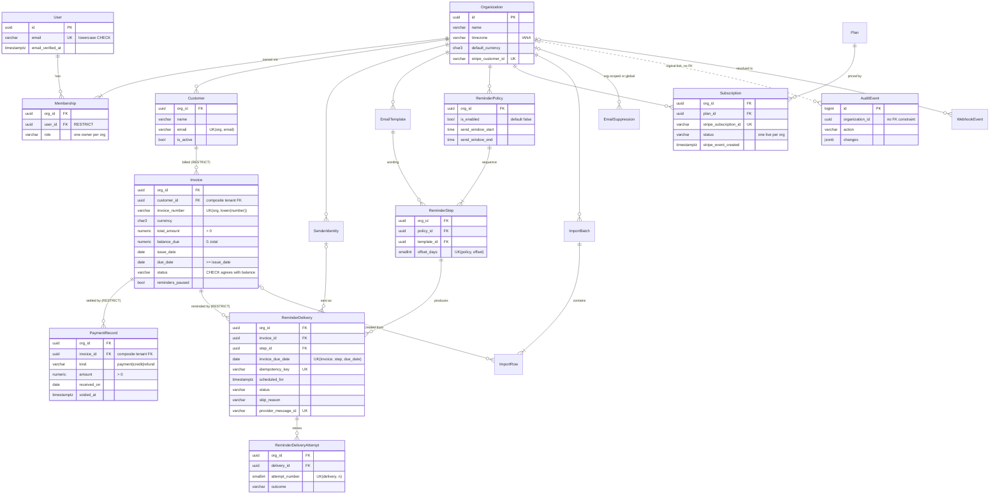

# InvoicePilot: Phase 2.1 Database Design

**Version:** 1.0 · **Date:** 2026-10-19 · **Baseline:** SRS v1.0 · **Status:** Implemented and tested against PostgreSQL 17

The code is the source of truth. This document explains the shape of the schema and the reasons behind it.

| | |
|---|---|
| Models | `invoicepilot/<app>/models.py` |
| Migrations | `invoicepilot/<app>/migrations/` (includes the hand-written `0002_*` migrations) |
| Schema tests | `tests/` (58 tests, run against PostgreSQL) |
| Retention job | `invoicepilot/retention/` (`manage.py purge_expired_data`) |

---

## 1. Summary

- **19 tables in 9 Django apps.** These are the 11 core entities from the SRS plus 8 supporting tables: sender identity, email template, delivery attempt, suppression, import batch, import row, plan and webhook event. Django's own auth and session tables are separate.
- **Shared database with workspace-scoped rows.** Every tenant-owned table has a non-null `organization_id`, including child tables.
- **PostgreSQL enforces the business rules,** not only Django. That covers cross-tenant links, balance and status agreement, duplicate reminders, duplicate webhooks, one owner per workspace and append-only audit. A bug in a view, a Celery task or a raw `UPDATE` still cannot corrupt that data.

## 2. Key decisions

| Decision | Choice | Reason |
|---|---|---|
| Framework version | Django 5.2 LTS | Supported until April 2028. Has `CheckConstraint(condition=…)`, functional unique constraints and `db_default`. |
| Primary keys | UUIDv7 (`core.ids.uuid7`) | IDs that appear in URLs can't be guessed or enumerated. The time prefix keeps index inserts close to append-only, unlike UUIDv4. `AuditEvent` uses `BIGINT` identity because it is high-volume and never exposed. |
| Money | `NUMERIC(14,2)` plus an ISO-4217 `currency` on each invoice | Exact decimal arithmetic and readable SQL. Currencies with three minor units (KWD, BHD) are excluded from the MVP list. For zero-decimal currencies such as JPY, the app rejects fractional amounts. |
| Outstanding balance | Stored `balance_due`, re-derived from payment records | BR-003 says the balance is *derived*. It is also *stored*, so dashboards, aging buckets and the reminder scan never have to aggregate payments. `Invoice.recalculate_balance()` is the only writer and runs under `SELECT … FOR UPDATE`. A CHECK keeps the value between 0 and the invoice total. |
| Invoice status | Stored, with a CHECK that ties it to the balance | Status can be indexed and filtered cheaply, and the database rejects contradictions such as `paid` with money still owed (§6). |
| "Overdue" | Never stored | It depends on the current date. It is computed as `due_date < today in the workspace timezone AND balance_due > 0` (BR-004). |
| Case-insensitive identity | Emails are lowercased, with a CHECK and a plain UNIQUE. Invoice numbers keep their original case, with UNIQUE on `(organization, lower(invoice_number))`. | Case-insensitive uniqueness (FR-001, BR-002) without depending on the `citext` extension. |
| Deletion | Deactivate, void or soft-cancel. `RESTRICT` blocks hard deletes. | FR-004 and auditability. Mistaken payments are voided, not deleted. |
| Verification and reset tokens | Not stored | Django's signed, time-limited token generators become invalid once the account state changes, which makes them single-use (FR-002). |
| Webhooks | Inbox table with `UNIQUE(provider, external_id)` | Provider retries become no-ops (FR-015, BR-016). |
| Uploaded CSVs | Only an object-storage key and a SHA-256 are stored | Persistent files must not live on a container filesystem (SRS §7). |
| Workspace without a subscription | Read-only (`Organization.read_only_since`) | Decided 2026-10-19. No trial or free tier for now. The workspace can view and export its data but cannot change data or send reminders. |

## 3. Entity-relationship diagram

`org_id` = `organization_id`. Every tenant table also has `id` (UUIDv7), `created_at` and `updated_at`.



## 4. Tenant isolation strategy

Isolation is enforced in four layers. Each layer covers a failure the one above it could miss.

**Layer 1: every tenant row carries `organization_id NOT NULL`.** This includes child rows such as `PaymentRecord`, `ReminderStep`, `ReminderDeliveryAttempt` and `ImportRow`, which could otherwise be reached through a join. Any query can be scoped with one indexed equality, and the column is ready for PostgreSQL Row-Level Security if Phase 2.4 adopts it.

**Layer 2: composite foreign keys (BR-017).** A normal FK only proves the parent row exists. It does not prove the parent belongs to the same workspace. Each parent that is referenced declares `UNIQUE (organization_id, id)` (`core.models.tenant_key`). Each child gets a second, composite FK:

```sql
ALTER TABLE invoices_invoice ADD CONSTRAINT invoices_invoice_customer_tenant_fk
  FOREIGN KEY (organization_id, customer_id)
  REFERENCES customers_customer (organization_id, id)
  DEFERRABLE INITIALLY DEFERRED;
```

Django has no built-in support for this, so the custom migration operation `core.migration_operations.AddTenantForeignKey` creates it. These constraints exist today:

| Child → parent | Child → parent |
|---|---|
| `Invoice.customer` → Customer | `ReminderDelivery.invoice` → Invoice |
| `PaymentRecord.invoice` → Invoice | `ReminderDelivery.step` → ReminderStep |
| `ImportRow.batch` → ImportBatch | `ReminderDelivery.sender_identity` → SenderIdentity |
| `ImportRow.invoice` → Invoice | `ReminderDeliveryAttempt.delivery` → ReminderDelivery |
| `ReminderStep.policy` → ReminderPolicy | `ReminderStep.template` → EmailTemplate |

Nullable links such as `ImportRow.invoice` still work, because PostgreSQL skips an FK check when one of its columns is NULL (`MATCH SIMPLE`). The constraints are deferred to match Django's own FKs, so cascades and fixture loading behave normally.

**Layer 3: application scoping.** Tenant models use `TenantQuerySet`. Views and services read through `Model.objects.for_organization(org)`, where `org` comes from the user's `Membership`, never from a request parameter. Phase 2.4 adds the middleware, a lint rule against unscoped `.get(pk=…)`, and permission checks in background workers.

**Layer 4: a regression guard.** `test_every_fk_between_tenant_tables_has_a_composite_tenant_constraint` reads `pg_constraint` and fails if anyone adds a tenant-to-tenant FK without its composite constraint.

**Global tables** (not tenant-owned): `User`, `Organization`, `Plan`, `WebhookEvent` (its organization is resolved during processing), `EmailSuppression` (a NULL organization means platform-wide) and `AuditEvent`.

**Rejected alternatives:**

- **Schema-per-tenant or database-per-tenant.** Migrations would run N times, connection pooling gets harder, and operating costs don't fit a $500 budget.
- **Relying only on ORM scoping.** One forgotten filter is a data breach.

**Deferred to Phase 2.4:** PostgreSQL RLS as an extra layer. The schema already supports it.

## 5. Table catalogue

All tenant tables share these columns: `id uuid PK`, `organization_id uuid NOT NULL FK`, `created_at` and `updated_at`.

### accounts

**User**: the login identity, separate from tenancy. Columns: `email` (unique and lowercase), `password` (Django PBKDF2 hash), `full_name`, `email_verified_at` (gates reminder automation, FR-001), `is_active`, `is_staff`, `date_joined`. The custom user model is in place before the first migration, as Django requires.

### organizations

**Organization**: the workspace. Columns: `name`, `timezone` (validated against IANA, BR-006), `default_currency` (CHECK: `^[A-Z]{3}$`), `stripe_customer_id` (unique), `is_active`, and `read_only_since`.

`read_only_since` is NULL while a subscription grants write access. Otherwise it holds the moment the workspace became read-only. New workspaces start read-only until checkout completes. Only `billing.access.sync_workspace_access()` writes it, after every Stripe subscription event, and it keeps the original timestamp so repeated events don't reset the retention clock. Every data-changing request and every reminder send checks `has_write_access()` on the server (BR-012).

**Membership**: links a user to a workspace with a `role`. Constraints: UNIQUE `(organization, user)`; a partial UNIQUE `(organization) WHERE role='owner'` gives exactly one owner, as the MVP requires; a CHECK limits role values. `user` uses RESTRICT, so a user who still owns a workspace cannot be deleted. Adding team roles later means a new enum value and dropping the partial unique, not a schema rewrite.

### customers

**Customer**: columns `name`, `email`, `company_name`, `notes`, `is_active`, `deactivated_at`.

- UNIQUE `(organization, email)`, with email lowercased by a CHECK.
- A CHECK keeps `is_active` and `deactivated_at` consistent with each other.
- Index on `(organization, name)` for list and search.

### invoices

**Invoice**

| Column | Type | Rules |
|---|---|---|
| `customer_id` | uuid | RESTRICT; composite tenant FK |
| `invoice_number` | varchar(64) | non-empty; UNIQUE `(organization, lower(invoice_number))` |
| `currency` | char(3) | CHECK `^[A-Z]{3}$`; app validates against the supported list |
| `total_amount` | numeric(14,2) | CHECK `> 0` |
| `balance_due` | numeric(14,2) | CHECK `0 ≤ balance_due ≤ total_amount` |
| `issue_date`, `due_date` | date | CHECK `due_date ≥ issue_date` |
| `status` | varchar | `open`, `partially_paid`, `paid`, `disputed` or `void`; CHECK against the balance (§6) |
| `reminders_paused`, `paused_at`, `pause_reason` | | CHECK: paused requires `paused_at` |
| `disputed_at`, `dispute_note`, `paid_at`, `voided_at` | | timestamps that drive and justify the status |
| `source` | varchar | `manual` or `csv_import` |
| `created_by_id` | uuid | SET NULL |

**PaymentRecord**: a payment, credit or refund that the user asserts happened. It is never a settlement claim (BR-015). Columns: `kind`, `amount` (CHECK `> 0`; the sign comes from `kind`), `received_on`, `method`, `reference`, `note`, `recorded_by_id`. To void a record, set `voided_at`, `voided_by_id` and `void_reason`. A CHECK requires `voided_at` whenever `voided_by` is set.

### imports

**ImportBatch**: one uploaded CSV. Columns: `file_key` (object storage), `file_sha256` (CHECK on hex format, indexed per workspace to warn on re-upload), `status` (uploaded → validated → committing → committed, or failed/cancelled), row counters, `committed_at` (required once committed), and `data_purged_at`. That last column is set when the retention job deletes the file and the row-level data; a CHECK allows it only on finished batches. The batch row itself is kept as a history entry.

**ImportRow**: `row_number` (UNIQUE per batch), `raw_data` and `errors` (jsonb, used for the row-level preview), `status`, and `invoice_id` (required when `imported`). Duplicates are caught twice: the invoice-number UNIQUE rejects them, and the preview marks them `duplicate` before commit. Re-importing the same file therefore cannot silently duplicate invoices (FR-007). Committing a batch never enables automation (BR-013).

### reminders

**SenderIdentity**: `from_name`, `reply_to_email` (UNIQUE per workspace, lowercase), `status` (pending, verified or revoked; `verified_at` is required when verified), `is_default` (one per workspace). The MVP sends from the platform domain using this display name and Reply-To.

**EmailTemplate**: `name` (UNIQUE per workspace), `subject`, `body_text`. Placeholders come from a fixed allow-list of fields.

**ReminderPolicy**: `is_enabled` (**defaults to false**), `is_default` (one per workspace), `send_window_start` and `send_window_end` in the workspace's local time (CHECK start < end), `send_on_weekends`.

**ReminderStep**: `policy_id`, `position`, `offset_days` (CHECK −30 to 365; UNIQUE per policy), `template_id` (RESTRICT), `is_active`. New workspaces are seeded with steps at +3, +7 and +14 days. Users can add **pre-due reminders** (negative offsets, up to 30 days before the due date) and a reminder on the due date itself (offset 0). This was decided on 2026-10-19 and extends FR-008.

**ReminderDelivery**: one logical reminder (§7). Columns: `invoice_id`, `step_id`, `sender_identity_id`, `invoice_due_date`, `idempotency_key` (UNIQUE), `scheduled_for`, `status`, `skip_reason`, a snapshot of `recipient_email`, `subject` and `body_text`, `attempt_count`, `provider_message_id` (UNIQUE), and the timestamps `queued_at`, `sent_at`, `delivered_at`, `failed_at` and `last_error`.

**ReminderDeliveryAttempt**: one call to the provider. Columns: `attempt_number` (≥ 1, UNIQUE per delivery), `started_at`, `finished_at`, `outcome` (in_progress, accepted, transient_error or permanent_error), `provider_status_code`, `error_message`.

**EmailSuppression**: `organization_id` (nullable), `email`, `reason`, `source`, `lifted_at` and `lifted_by`. A CHECK ties scope to reason: hard bounces and complaints are **platform-wide** (NULL organization) because they affect shared sender reputation, while unsubscribes and manual blocks are **workspace-only**. A partial UNIQUE allows one active entry per scope and address. Lifting an entry keeps its history.

### billing

**Plan** (global): `code`, `name` and `stripe_price_id` (each unique), plus the limits `max_customers`, `max_invoices_per_month` and `max_reminders_per_month` (NULL means unlimited), and `is_active`.

**Subscription**: a mirror of Stripe, written only by verified webhooks. Columns: `plan_id` (PROTECT), `stripe_subscription_id` (UNIQUE, so replayed events update the row rather than duplicate it), `status` (Stripe's values), the period fields, `cancel_at_period_end`, `canceled_at`, `ended_at`, `trial_end`, and `stripe_event_created`. Events older than `stripe_event_created` are ignored, which protects against out-of-order delivery. A partial UNIQUE allows **one live subscription per workspace**, while canceled history rows can accumulate.

Write access is granted by `active` and `past_due`, and by `trialing` if a trial is ever configured. `past_due` stays writable while Stripe retries the card. When Stripe gives up, the subscription moves to `unpaid` or `canceled` and the workspace becomes read-only.

### audit

**AuditEvent**: `actor_type` (user, admin, worker, webhook or system), `actor_user_id`, `action` (for example `invoice.status_changed` or `admin.support_access`), `target_type` and `target_id`, `changes` (jsonb of old and new values for changed fields only), `metadata` (request id, IP address, support-access justification) and `created_at` (set by the database).

- **Append-only:** a trigger rejects UPDATE and DELETE.
- The retention job is the only deleter. It must run `SET LOCAL invoicepilot.audit_purge = 'on'` first.
- `organization_id` and `actor_user_id` have no FK constraint and never cascade, so deleting a workspace cannot erase its history.
- Indexes: `(organization, created_at desc)` and `(target_type, target_id)`.

### webhooks

**WebhookEvent**: `provider` (stripe or email), `external_id` (UNIQUE per provider), `event_type`, `payload` (jsonb), `status` (received, processed, ignored or failed), `attempts`, `processed_at`, `last_error`, and `organization_id`, which is resolved during processing. Only signature-verified events are inserted. A partial index on pending and failed events drives reprocessing.

## 6. Invoice balance and status rules

**Balance formula:**

`balance_due = total_amount − Σ(payment + credit) + Σ(refund)`

The sums cover non-voided records only. The result must stay between 0 and the total, or `recalculate_balance()` raises an error.

**Status precedence** (`derive_status()`): void, then paid (balance = 0), then disputed, then open (balance = total), then partially_paid.

The database CHECK `invoices_invoice_status_consistent` allows only these combinations:

| status | Required state |
|---|---|
| `open` | `balance_due = total_amount` |
| `partially_paid` | `0 < balance_due < total_amount` |
| `paid` | `balance_due = 0` and `paid_at` set |
| `disputed` | `balance_due > 0` and `disputed_at` set |
| `void` | `voided_at` set |

Reminder eligibility: `status IN ('open','partially_paid') AND NOT reminders_paused`. The invoice does not need to be overdue, because pre-due steps are allowed. This matches the partial index `invoices_reminder_scan_idx`. Paid, disputed, void and paused invoices are therefore never candidates (BR-005). Suppression, sender verification, policy state and plan limits are checked again just before sending (§7).

## 7. Reminder data model

- **Logical key:** `UNIQUE (invoice_id, step_id, invoice_due_date)` (BR-008). If the scheduler runs twice, the second insert fails and becomes a no-op. The worker then advances the existing row instead of creating a new one. `idempotency_key` is built deterministically from the same three values and is sent to the email provider.
- **Due-date change** (BR-009): the logical key changes. The old `scheduled` row is cancelled with `skip_reason = 'schedule_changed'` and a new row is scheduled. History that was already sent is kept.
- **Retries** are `ReminderDeliveryAttempt` rows. The delivery itself stays one row.
- **Explainability** (FR-010): a `skipped` or `cancelled` row must have a `skip_reason`. A row that is `sent`, `delivered`, `bounced` or `complained` must have `sent_at` and `provider_message_id`.
- **Statuses:** scheduled, queued, sending, sent, delivered, bounced, complained, failed, skipped, cancelled. Phase 2.5 defines the allowed transitions and how the worker locks rows (`SELECT … FOR UPDATE SKIP LOCKED`).
- **Indexes:** a partial index on `scheduled_for WHERE status='scheduled'` (the scheduler scan), `(organization, scheduled_for desc)` for the activity page, and a partial index on `(organization, sent_at)` for monthly sending limits.

## 8. Deletion and retention

| Relationship | On delete | Reason |
|---|---|---|
| Organization → tenant rows | CASCADE | Account purge (BR data-protection policy) |
| Customer → Invoice | RESTRICT | FR-004: no hard delete once invoiced. Deactivate instead. |
| Invoice → PaymentRecord, ReminderDelivery | RESTRICT | Financial and audit history. Void instead. |
| ReminderStep → ReminderDelivery | RESTRICT | Deactivate the step instead |
| EmailTemplate → ReminderStep | RESTRICT | Avoids a step with no wording |
| User → Membership | RESTRICT | Avoids ownerless workspaces |
| Plan → Subscription | PROTECT | Billing history |
| AuditEvent links | none | Purged only by the retention job |

`RESTRICT` (not `PROTECT`) is used inside a tenant so that a workspace purge can cascade through the whole tree. A test covers this.

### Retention periods (decided 2026-10-19)

The periods live in `invoicepilot/retention/policy.py`. `manage.py purge_expired_data` applies them; it is idempotent and runs daily (Celery beat in Phase 2.5). Each run writes a `retention.purged` audit event with its counts.

| Data | Kept for | Reason |
|---|---|---|
| Audit events | 12 months, rolling | Long enough to investigate security incidents and review support access. 12 months is the common benchmark (for example PCI DSS 10.5.1). They survive workspace deletion until they age out. |
| Webhook events (processed or ignored) | 30 days | Payloads contain personal data. Replay protection only needs a few days, since Stripe retries for up to 3. |
| Webhook events (received or failed) | 90 days | Extra time to investigate failures |
| Uploaded CSV file and row-level preview data | 30 days after the batch finishes | The data now lives in invoices, so the raw copy is only for debugging imports. The batch summary row is kept. |
| Abandoned imports (never committed) | 7 days | Cancelled, then purged |
| Read-only workspace | 90 days, then due for deletion | Covers FR-015's "data remains available for export". The job only counts these workspaces for now. Automatic deletion waits until warning emails at 30 and 7 days exist. |
| Invoices, payments, customers, reminder history | While the workspace exists | This is the user's business data. |
| Email suppressions | Indefinitely | Forgetting an opt-out would mean emailing someone who asked to stop. |
| Deletion request from the user | Within 30 days | GDPR requires erasure "without undue delay", answered within one month. |

**Not legal advice.** These periods are a reasonable SaaS baseline, not a legal review. Before general availability, a lawyer should confirm them for the countries you sell into, and the published privacy policy must state the same numbers. Tax record-keeping (often 5 to 7 years, depending on the country) is the freelancer's own obligation, not InvoicePilot's. The CSV export is how they meet it, and the policy should say so.

## 9. Index plan

| Query | Index |
|---|---|
| Dashboard totals, aging buckets, overdue list | `invoices_unsettled_due_idx (organization, due_date) WHERE status IN (open, partially_paid, disputed)` |
| Invoice list, newest first | `invoices_org_issue_idx (organization, issue_date desc)` |
| Monthly invoice limit | `invoices_org_created_idx (organization, created_at)` |
| Reminder candidates across workspaces | `invoices_reminder_scan_idx (due_date) WHERE status IN (open, partially_paid) AND NOT reminders_paused` |
| Reminders due now | `reminders_delivery_due_idx (scheduled_for) WHERE status = 'scheduled'` |
| Activity page | `reminders_delivery_org_idx (organization, scheduled_for desc)` |
| Monthly sending limit | `reminders_delivery_sent_idx (organization, sent_at) WHERE sent_at IS NOT NULL` |
| Customer list and search | `customers_org_name_idx (organization, name)` |
| Exports by payment date | `invoices_payment_org_recv_idx (organization, received_on)` |
| Webhook reprocessing | `webhooks_pending_idx (received_at) WHERE status IN (received, failed)` |

Django also creates an index on every FK column. Following the NFR, more indexes, such as `pg_trgm` for fuzzy search, wait until real query plans show they are needed.

## 10. Traceability

| Requirement | Enforced by | Test |
|---|---|---|
| FR-001 unique email, case-insensitive | `User.email` UNIQUE + lowercase CHECK | `test_user_email_is_unique_ignoring_case` |
| FR-003 one owner per workspace | partial UNIQUE on Membership | `test_workspace_has_exactly_one_owner` |
| FR-004, BR-010 cross-workspace access | composite FKs, `for_organization` | `test_tenant_isolation.py` (6 tests) |
| FR-004 no hard delete with invoices | `Invoice.customer` RESTRICT | `test_customer_with_invoices_cannot_be_deleted` |
| FR-005, BR-002 invoice integrity | CHECKs + functional UNIQUE | `test_database_rejects_invalid_invoices` (8 cases), `test_invoice_number_unique_…` |
| FR-006, BR-003 balance and status | `recalculate_balance`, status CHECK | `test_balance_and_status_follow_payment_records`, `test_overpayment_is_refused` |
| BR-004 overdue | `Invoice.is_overdue` | `test_overdue_requires_past_due_date_and_open_balance` |
| FR-007 import provenance | ImportRow CHECK, invoice-number UNIQUE | `test_imported_row_must_point_to_its_invoice` |
| FR-008, BR-013 automation opt-in | `ReminderPolicy.is_enabled` defaults to false | `test_policy_rules` |
| BR-008 no duplicate reminders | logical UNIQUE + idempotency key | `test_one_logical_reminder_per_invoice_step_and_due_date` |
| FR-010, FR-011 explainable outcomes | delivery CHECKs, attempt table | `test_delivery_state_must_be_explainable` |
| BR-014 suppression | EmailSuppression scope CHECK and partial UNIQUEs | `test_suppression_scope_and_lookup`, `test_lifted_…` |
| FR-015 no duplicate subscriptions | UNIQUE Stripe id, one live per org | `test_one_live_subscription_per_workspace` |
| BR-016 webhook replay | UNIQUE `(provider, external_id)` | `test_replayed_webhook_is_rejected` |
| BR-017 same-workspace links | composite FKs + introspection guard | `test_every_fk_between_tenant_tables_…` |
| NFR audit trail | append-only trigger | `test_audit_events_are_append_only` |
| FR-008 pre-due reminders | `offset_days` CHECK −30 to 365 | `test_reminders_may_be_scheduled_before_the_due_date` |
| BR-012 read-only without a subscription | `read_only_since`, `sync_workspace_access` | `test_new_workspace_is_read_only_…`, `test_write_access_follows_subscription_status` (6 cases) |
| NFR data protection: retention | `retention.purge` | `test_retention_and_access.py` |

These tests are not yet written. They belong to later phases: reminder timing (2.5), plan-limit enforcement and webhook signature checks (2.4), CSV parsing (implementation).

## 11. Decision log and open questions

Decided by the product owner on 2026-10-19:

| # | Question | Decision |
|---|---|---|
| D1 | Is a customer's email unique within a workspace? | **Yes.** UNIQUE `(organization, email)` stays. Two clients can't share one billing inbox in the MVP. |
| D2 | How long is data kept? | **Audit log: 1 year.** The other periods are shorter, as proposed in §8. Legal review is still required before general availability. |
| D3 | What can a workspace without a subscription do? | **Read-only.** No trial and no free tier for now. New sign-ups subscribe before they can create data. This can be revisited later. |
| D4 | Are reminders before the due date allowed? | **Yes**, from 30 days before the due date. The default sequence stays +3, +7 and +14 days. |

Still open:

1. **Currencies with three minor units** (KWD, BHD, OMR). They are excluded today. Confirm that no pilot customer needs them.
2. **Workspace deletion e-mails.** The wording and sending of the 30- and 7-day warnings come before automatic deletion can be switched on (Phase 2.5).

Handed to later phases: RLS and database-role separation, including revoking UPDATE/DELETE on the audit table (2.4); reminder state transitions and locking (2.5); backups, restore drills and migrations in CI (2.6).

## 12. Run it locally

```bash
uv sync          # installs runtime + dev dependencies from uv.lock
export DJANGO_DEBUG=1 POSTGRES_HOST=localhost POSTGRES_PORT=5432 POSTGRES_DB=invoicepilot POSTGRES_USER=invoicepilot
uv run python manage.py migrate
uv run pytest    # 58 schema tests; needs PostgreSQL (SQLite is not supported)
uv run python manage.py purge_expired_data   # apply the retention policy (daily in production)
```
