# InvoicePilot: Phase 2.1 Database Design

**Version:** 2.0 · **Date:** 2026-10-20 · **Baseline:** SRS v1.0 · **Database:** PostgreSQL 17, Django 5.2 LTS

**Status:** v1.0 of this schema is implemented and tested. The v2.0 changes (payment reversals, the outbox, optimistic locking and the others listed in §15) are **designed but not migrated yet**. Each section marks those changes with **[v2]**.

This document is the contract for the schema. Wherever it matches the code, the code is the source of truth. Wherever it is marked **[v2]**, the code still has to catch up.

| | |
|---|---|
| Models | `invoicepilot/<app>/models.py` |
| Migrations | `invoicepilot/<app>/migrations/` (includes the hand-written `0002_*` migrations) |
| Schema tests | `tests/` (58 tests for v1.0, run against PostgreSQL) |
| Retention job | `invoicepilot/retention/` (`manage.py purge_expired_data`) |

---

## 1. Summary

- **20 application tables in 10 Django apps.** These are the 19 entities the product needs plus `Plan`, the global price list that `Subscription` points to. Django's own auth, session, admin and content-type tables are separate.
- **One shared database, with every business row tagged by workspace.** Every tenant-owned table has a non-null `organization_id`, including child tables such as payments and delivery attempts.
- **PostgreSQL enforces the rules, not only Django.** Cross-tenant links, balance and status agreement, duplicate reminders, duplicate webhooks, one owner per workspace, the append-only payment ledger and the append-only audit log are all enforced by the database. A bug in a view, a Celery task or a hand-written `UPDATE` still cannot corrupt that data.
- **Money is exact and the payment history is never edited.** Amounts are `NUMERIC(14,2)`. A mistaken payment is corrected with a reversal entry. The original payment row is never updated or deleted **[v2]**.
- **Side effects leave through an outbox.** Any change that needs follow-up work, such as rescheduling reminders after a payment, writes an `OutboxEvent` in the same transaction. A relay delivers it at least once **[v2]**.

## 2. Key decisions

| Decision | Choice | Reason |
|---|---|---|
| Framework version | Django 5.2 LTS | Supported until April 2028. Provides `CheckConstraint(condition=…)`, functional unique constraints, `db_default` and `select_for_update(no_key=True)`. |
| Primary keys | UUIDv7 (`core.ids.uuid7`), generated by the application | IDs that appear in URLs and the future API can't be guessed or enumerated. The time prefix keeps index inserts close to append-only, which UUIDv4 does not. `AuditEvent` uses a `BIGINT` identity instead, because it is high-volume and never exposed. |
| Money | `NUMERIC(14,2)` plus an ISO-4217 `currency` on each invoice | Exact decimal arithmetic and readable SQL. See §7. |
| Outstanding balance | Stored as `balance_due` and re-derived from the payment ledger | Dashboards, aging buckets and the reminder scan never have to add up payments. `Invoice.recalculate_balance()` is the only code that writes it, and it runs under a row lock. A CHECK keeps the value between 0 and the invoice total. |
| Invoice status | Stored, with a CHECK that ties it to the balance | Status is cheap to index and filter on, and the database rejects contradictions such as `paid` while money is still owed (§8). |
| "Overdue" | Never stored | It depends on today's date. It is computed as `due_date < today in the workspace timezone AND balance_due > 0`. |
| Payment corrections **[v2]** | An append-only ledger with explicit `reversal` entries | History is never rewritten, and the database blocks UPDATE and DELETE on payment rows. Replaces v1.0's `voided_at` columns. |
| Side effects **[v2]** | A transactional outbox (`OutboxEvent`) | `transaction.on_commit()` loses the task if the process dies between the commit and the broker publish. An outbox row commits atomically with the change it describes. |
| Concurrent edits **[v2]** | Row locks for money; a `version` column for forms | Payments and sends serialize on the invoice row. Two people editing the same form are detected by a version check, so the second save gets a conflict instead of silently overwriting the first. |
| Case-insensitive identity | Emails are stored lowercase, with a CHECK and a plain UNIQUE. Invoice numbers keep their case, with UNIQUE on `(organization, lower(invoice_number))`. | Case-insensitive uniqueness without depending on the `citext` extension. |
| Deletion | Deactivate, void or reverse. `RESTRICT` blocks hard deletes. | Auditability and financial history. |
| Verification and reset tokens | Not stored | Django's signed, time-limited token generators become invalid once the account state changes, which makes them single-use. |
| Webhooks | An inbox table with `UNIQUE(provider, external_id)` | Provider retries become no-ops. |
| Uploaded CSVs | Only an object-storage key and a SHA-256 are stored | Persistent files must not live on a container filesystem. |
| Workspace without a subscription | Read-only (`Organization.read_only_since`) | Decided 2026-10-19 (D3). |

## 3. Entity-relationship diagram

Every tenant table also has `id`, `organization_id`, `created_at` and `updated_at`. To keep the diagram readable, the lines from `Organization` go only to tables that hang directly off the workspace, and only key or constrained columns are shown. §6 lists every column.

```mermaid
erDiagram
    User ||--o{ Membership : "has"
    Organization ||--|{ Membership : "has"
    Organization ||--o{ Customer : "owns"
    Organization ||--o{ EmailTemplate : "owns"
    Organization ||--o{ SenderIdentity : "owns"
    Organization ||--o{ ReminderPolicy : "owns"
    Organization ||--o{ Subscription : "billed via"
    Organization ||--o{ ImportBatch : "owns"
    Organization |o--o{ EmailSuppression : "scopes, NULL is global"
    Organization |o--o{ WebhookEvent : "resolved to"
    Organization |o--o{ OutboxEvent : "emits"
    Organization |o..o{ AuditEvent : "logged, no FK"
    Customer ||--o{ Invoice : "billed"
    ReminderPolicy |o--o{ Invoice : "overrides default"
    Invoice ||--o{ PaymentRecord : "ledger"
    PaymentRecord |o--o| PaymentRecord : "reversed by"
    User ||--o{ PaymentRecord : "recorded"
    ReminderPolicy ||--o{ ReminderStep : "sequence"
    EmailTemplate ||--o{ ReminderStep : "wording"
    Invoice ||--o{ ReminderDelivery : "reminded by"
    ReminderStep ||--o{ ReminderDelivery : "produces"
    SenderIdentity |o--o{ ReminderDelivery : "sent as"
    ReminderDelivery ||--o{ DeliveryAttempt : "attempts"
    Plan ||--o{ Subscription : "prices"
    ImportBatch ||--|{ ImportRow : "contains"
    Invoice |o--o{ ImportRow : "created from"
    User |o--o{ ImportBatch : "uploaded"

    User {
        uuid id PK
        varchar email UK "lowercase CHECK"
        varchar password "Django hash"
        timestamptz email_verified_at
        bool is_active
    }
    Organization {
        uuid id PK
        varchar name
        varchar timezone "IANA"
        varchar default_currency "ISO 4217"
        varchar stripe_customer_id UK
        timestamptz read_only_since
    }
    Membership {
        uuid id PK
        uuid organization_id FK
        uuid user_id FK "RESTRICT"
        varchar role "one owner per org"
    }
    Customer {
        uuid id PK
        uuid organization_id FK
        varchar name
        varchar email "UK per org"
        bool is_active
        int version "v2"
    }
    Invoice {
        uuid id PK
        uuid organization_id FK
        uuid customer_id FK "composite tenant FK"
        uuid reminder_policy_id FK "v2, nullable"
        varchar invoice_number "UK org, lower"
        varchar currency "ISO 4217"
        numeric total_amount "gt 0"
        numeric balance_due "0 to total"
        date issue_date
        date due_date "gte issue_date"
        varchar status "CHECK agrees with balance"
        bool reminders_paused
        int version "v2"
    }
    PaymentRecord {
        uuid id PK
        uuid organization_id FK
        uuid invoice_id FK "composite tenant FK"
        varchar kind "payment credit refund reversal"
        numeric amount "gt 0"
        numeric balance_effect "v2, signed"
        uuid reverses_id FK "v2, UK, same invoice"
        varchar idempotency_key "v2, UK per org"
        date received_on
    }
    ReminderPolicy {
        uuid id PK
        uuid organization_id FK
        bool is_enabled "default false"
        bool is_default "one per org"
        time send_window_start
        time send_window_end
    }
    ReminderStep {
        uuid id PK
        uuid organization_id FK
        uuid policy_id FK "composite tenant FK"
        uuid template_id FK "composite tenant FK"
        smallint offset_days "UK per policy, -30 to 365"
    }
    EmailTemplate {
        uuid id PK
        uuid organization_id FK
        varchar name "UK per org"
        varchar subject
        text body_text
    }
    SenderIdentity {
        uuid id PK
        uuid organization_id FK
        varchar reply_to_email "UK per org"
        varchar status "pending verified revoked"
        bool is_default "one per org"
    }
    ReminderDelivery {
        uuid id PK
        uuid organization_id FK
        uuid invoice_id FK "composite tenant FK"
        uuid step_id FK "composite tenant FK"
        uuid sender_identity_id FK "composite tenant FK"
        date invoice_due_date "UK invoice, step, due date"
        varchar idempotency_key UK
        timestamptz scheduled_for
        varchar status
        timestamptz lease_expires_at "v2"
        varchar provider_message_id UK
    }
    DeliveryAttempt {
        uuid id PK
        uuid organization_id FK
        uuid delivery_id FK "composite tenant FK"
        smallint attempt_number "UK per delivery"
        varchar outcome "adds unknown in v2"
    }
    EmailSuppression {
        uuid id PK
        uuid organization_id FK "NULL means platform-wide"
        varchar email "one active per scope"
        varchar reason
        timestamptz lifted_at
    }
    Plan {
        uuid id PK
        varchar code UK
        varchar stripe_price_id UK
    }
    Subscription {
        uuid id PK
        uuid organization_id FK
        uuid plan_id FK "PROTECT"
        varchar stripe_subscription_id UK
        varchar status "one live per org"
        timestamptz stripe_event_created
    }
    ImportBatch {
        uuid id PK
        uuid organization_id FK
        varchar file_key
        varchar file_sha256
        varchar status
    }
    ImportRow {
        uuid id PK
        uuid organization_id FK
        uuid batch_id FK "composite tenant FK"
        uuid invoice_id FK "composite tenant FK"
        int row_number "UK per batch"
        jsonb raw_data
    }
    AuditEvent {
        bigint id PK
        uuid organization_id "no FK constraint"
        varchar action
        jsonb changes
        timestamptz created_at
    }
    WebhookEvent {
        uuid id PK
        varchar provider "UK with external_id"
        varchar external_id
        varchar status
        uuid organization_id FK "resolved later"
    }
    OutboxEvent {
        uuid id PK
        uuid organization_id FK "nullable"
        varchar topic
        varchar dedupe_key UK
        varchar status
        timestamptz available_at
    }
```



## 4. Conventions

### Column types

| Purpose | PostgreSQL | Django | Notes |
|---|---|---|---|
| Primary key | `uuid` | `UUIDField(primary_key=True, default=uuid7)` | `AuditEvent` uses `bigint` identity |
| Foreign key | `uuid` | `ForeignKey` | Indexed automatically by Django |
| Money | `numeric(14,2)` | `DecimalField(max_digits=14, decimal_places=2)` | §7 |
| Currency | `varchar(3)` | `CharField(3)` | CHECK `^[A-Z]{3}$` |
| Email | `varchar(254)` | `EmailField` | Stored lowercase where it is matched or unique |
| Short text | `varchar(n)` | `CharField` | |
| Long text | `text` | `TextField` | |
| Calendar date | `date` | `DateField` | Due dates and payment dates have no time of day |
| Instant | `timestamptz` | `DateTimeField` (`USE_TZ=True`) | Stored in UTC |
| Local time of day | `time` | `TimeField` | Interpreted in `Organization.timezone` |
| Counter | `smallint` or `integer` | `Positive…Field` | Django adds a `>= 0` CHECK |
| Structured data | `jsonb` | `JSONField` | Never secrets or card data |

**Empty text.** Optional text columns follow the Django convention: `NOT NULL`, with `''` meaning empty. Only optional non-text columns, such as timestamps and foreign keys, are nullable.

**Table names** follow Django's `<app>_<model>` default, for example `invoices_invoice`. Constraint names start with the app label so they are unique across the database.

**Base columns.** Every tenant table inherits `core.models.TenantModel`:

```sql
id              uuid        PRIMARY KEY,          -- UUIDv7, generated by the application
organization_id uuid        NOT NULL REFERENCES organizations_organization,
created_at      timestamptz NOT NULL,
updated_at      timestamptz NOT NULL
```

Exceptions: append-only tables (`PaymentRecord` **[v2]**, `AuditEvent`, `OutboxEvent`) have `created_at` only, with `db_default=Now()` so the database sets it.

### How deletes work in Django 5.2

Django creates every foreign key as `DEFERRABLE INITIALLY DEFERRED` **with no `ON DELETE` clause**, which means `NO ACTION`. The `on_delete` choices (`CASCADE`, `RESTRICT`, `PROTECT`, `SET_NULL`) are carried out in Python by Django's deletion collector. In practice:

- A delete through the ORM follows the `on_delete` rules in the tables below.
- A raw SQL `DELETE` of a row that still has children fails at commit. The database never cascades by itself. That is the safe default.
- `RESTRICT` is used inside a workspace instead of `PROTECT`. `RESTRICT` blocks a direct delete but allows the delete when it is part of a workspace purge cascading down from `Organization`.

## 5. Tenant isolation

Isolation is enforced in four layers. Each layer catches a mistake the layer above it could miss.

**Layer 1: every tenant row carries `organization_id NOT NULL`.** This includes child rows such as `PaymentRecord`, `ReminderStep`, `DeliveryAttempt` and `ImportRow`, which could otherwise only be reached through a join. Any query can be scoped with one indexed equality, and the column is ready for PostgreSQL Row-Level Security if Phase 2.4 adopts it.

**Layer 2: composite foreign keys.** A normal foreign key only proves that the parent row exists. It does not prove the parent belongs to the same workspace. Without more, `invoice.customer_id` could point at another workspace's customer. So:

1. Each parent table that is referenced declares `UNIQUE (organization_id, id)` (`core.models.tenant_key`).
2. Each child keeps Django's single-column foreign key, which drives the ORM and `on_delete`, and gets a second, composite foreign key:

```sql
ALTER TABLE invoices_invoice ADD CONSTRAINT invoices_invoice_customer_tenant_fk
  FOREIGN KEY (organization_id, customer_id)
  REFERENCES customers_customer (organization_id, id)
  DEFERRABLE INITIALLY DEFERRED;
```

Django has no built-in support for this, so the custom migration operation `core.migration_operations.AddTenantForeignKey` creates it. Nullable links such as `ImportRow.invoice` still work, because PostgreSQL skips the check when one of the columns is NULL (`MATCH SIMPLE`).

**Complete list of composite tenant foreign keys:**

| # | Child column | → Parent | Parent key used | Status |
|---|---|---|---|---|
| 1 | `Invoice.customer` | Customer | `(organization_id, id)` | v1.0 |
| 2 | `Invoice.reminder_policy` | ReminderPolicy | `(organization_id, id)` | **[v2]** |
| 3 | `PaymentRecord.invoice` | Invoice | `(organization_id, id)` | v1.0 |
| 4 | `PaymentRecord.reverses` | PaymentRecord | `(organization_id, invoice_id, id)`, so a reversal must also be on **the same invoice** | **[v2]** |
| 5 | `ReminderStep.policy` | ReminderPolicy | `(organization_id, id)` | v1.0 |
| 6 | `ReminderStep.template` | EmailTemplate | `(organization_id, id)` | v1.0 |
| 7 | `ReminderDelivery.invoice` | Invoice | `(organization_id, id)` | v1.0 |
| 8 | `ReminderDelivery.step` | ReminderStep | `(organization_id, id)` | v1.0 |
| 9 | `ReminderDelivery.sender_identity` | SenderIdentity | `(organization_id, id)` | v1.0 |
| 10 | `DeliveryAttempt.delivery` | ReminderDelivery | `(organization_id, id)` | v1.0 (renamed in v2) |
| 11 | `ImportRow.batch` | ImportBatch | `(organization_id, id)` | v1.0 |
| 12 | `ImportRow.invoice` | Invoice | `(organization_id, id)` | v1.0 |

Number 4 needs a three-column composite key, which `AddTenantForeignKey` doesn't support yet. It will be written as a `RunSQL` migration:

```sql
ALTER TABLE invoices_paymentrecord
  ADD CONSTRAINT invoices_paymentrecord_invoice_key UNIQUE (organization_id, invoice_id, id);

ALTER TABLE invoices_paymentrecord ADD CONSTRAINT invoices_paymentrecord_reverses_same_invoice_fk
  FOREIGN KEY (organization_id, invoice_id, reverses_id)
  REFERENCES invoices_paymentrecord (organization_id, invoice_id, id)
  DEFERRABLE INITIALLY DEFERRED;
```

**Links that need no composite key:** links to global tables (`User`, `Plan`), and `Membership`, `Subscription`, `EmailSuppression`, `WebhookEvent` and `OutboxEvent`, which link only to `Organization` itself.

**One rule the database can't check:** a delivery's step should belong to the policy that applies to its invoice. Policies can change after a delivery is scheduled, so the scheduler enforces this when it plans deliveries, not the schema.

**Layer 3: application scoping.** Tenant models use `TenantQuerySet`. Views and services read through `Model.objects.for_organization(org)`, where `org` comes from the user's `Membership`, never from a request parameter. Phase 2.4 adds the middleware, a lint rule against unscoped `.get(pk=…)`, and permission checks in background workers.

**Layer 4: a regression guard.** `test_every_fk_between_tenant_tables_has_a_composite_tenant_constraint` reads `pg_constraint` and fails if anyone adds a tenant-to-tenant foreign key without its composite constraint. It covers keys 2 and 4 automatically once they exist.

**Global tables** (not tenant-owned): `User`, `Organization`, `Plan`, `EmailSuppression` (a NULL organization means platform-wide), `WebhookEvent` (its organization is resolved during processing), `AuditEvent` and `OutboxEvent` (both have a nullable organization).

**Rejected alternatives:**

- **Schema-per-tenant or database-per-tenant.** Migrations would run N times, connection pooling gets harder, and operating costs don't fit the budget.
- **Relying only on ORM scoping.** One forgotten filter is a data breach.

**Deferred to Phase 2.4:** PostgreSQL RLS as an extra layer, which needs per-request tenant context that is safe with connection pooling, and a database role that cannot bypass policies. The schema already supports it.

## 6. Table catalogue

Columns are listed in the order they will appear. "Base" means the tenant base columns from §4. **[v2]** marks a column or constraint that the code does not have yet.

### 6.1 accounts

#### `accounts_user` (global)

The login identity. Access to a workspace is granted only through `Membership`. The custom user model existed before the first migration, as Django requires.

| Column | Type | Null | Default | Rules |
|---|---|---|---|---|
| `id` | uuid | no | uuid7 | PK |
| `email` | varchar(254) | no | | UNIQUE; CHECK `email = lower(email)` |
| `password` | varchar(128) | no | | Django password hash, never plaintext |
| `full_name` | varchar(150) | no | `''` | |
| `email_verified_at` | timestamptz | yes | | Must be set before reminder automation can be enabled |
| `is_active` | boolean | no | true | |
| `is_staff` | boolean | no | false | |
| `is_superuser` | boolean | no | false | From `PermissionsMixin` |
| `last_login` | timestamptz | yes | | |
| `date_joined` | timestamptz | no | now | |

`PermissionsMixin` also creates the join tables `accounts_user_groups` and `accounts_user_user_permissions`.

### 6.2 organizations

#### `organizations_organization` (global, the tenant root)

| Column | Type | Null | Default | Rules |
|---|---|---|---|---|
| `id` | uuid | no | uuid7 | PK |
| `name` | varchar(200) | no | | |
| `timezone` | varchar(64) | no | `'UTC'` | CHECK not empty; validated against IANA names in the app |
| `default_currency` | varchar(3) | no | | CHECK `^[A-Z]{3}$`; validated against the supported list in the app |
| `stripe_customer_id` | varchar(255) | yes | | UNIQUE |
| `is_active` | boolean | no | true | |
| `read_only_since` | timestamptz | yes | now | NULL while a subscription grants write access. Written only by `billing.access.sync_workspace_access()`. |
| `created_at`, `updated_at` | timestamptz | no | | |

#### `organizations_membership`

| Column | Type | Null | Default | Rules |
|---|---|---|---|---|
| `id` | uuid | no | uuid7 | PK |
| `organization_id` | uuid | no | | FK → Organization, CASCADE |
| `user_id` | uuid | no | | FK → User, RESTRICT (a user who still owns a workspace cannot be deleted) |
| `role` | varchar(20) | no | `'owner'` | CHECK `role IN ('owner')` |
| `created_at`, `updated_at` | timestamptz | no | | |

- UNIQUE `(organization_id, user_id)`.
- Partial UNIQUE `(organization_id) WHERE role = 'owner'`: at most one owner. The workspace-creation service creates the owner in the same transaction as the workspace, so in practice there is exactly one.
- Adding team roles later means a new CHECK value, not a schema rewrite.

### 6.3 customers

#### `customers_customer`

| Column | Type | Null | Default | Rules |
|---|---|---|---|---|
| Base | | | | |
| `name` | varchar(200) | no | | |
| `email` | varchar(254) | no | | CHECK lowercase; UNIQUE `(organization_id, email)` (decision D1) |
| `company_name` | varchar(200) | no | `''` | |
| `notes` | text | no | `''` | |
| `is_active` | boolean | no | true | |
| `deactivated_at` | timestamptz | yes | | CHECK: set if and only if `is_active` is false |
| `version` **[v2]** | integer | no | 1 | Optimistic lock (§11.6) |

Constraints: `customers_customer_tenant_key UNIQUE (organization_id, id)`. Index: `(organization_id, name)`.

### 6.4 invoices

#### `invoices_invoice`

| Column | Type | Null | Default | Rules |
|---|---|---|---|---|
| Base | | | | |
| `customer_id` | uuid | no | | FK RESTRICT; composite tenant FK |
| `reminder_policy_id` **[v2]** | uuid | yes | | FK RESTRICT; composite tenant FK. NULL means the workspace's default policy applies. |
| `invoice_number` | varchar(64) | no | | CHECK not empty; UNIQUE `(organization_id, lower(invoice_number))` |
| `currency` | varchar(3) | no | | CHECK `^[A-Z]{3}$`; validated against the supported list |
| `total_amount` | numeric(14,2) | no | | CHECK `> 0` |
| `balance_due` | numeric(14,2) | no | | CHECK `0 <= balance_due <= total_amount` |
| `issue_date` | date | no | | |
| `due_date` | date | no | | CHECK `due_date >= issue_date` |
| `status` | varchar(20) | no | `'open'` | `open`, `partially_paid`, `paid`, `disputed`, `void`; CHECK against the balance (§8.4) |
| `description` | text | no | `''` | |
| `source` | varchar(20) | no | `'manual'` | `manual`, `csv_import`; `api` is added **[v2]** |
| `reminders_paused` | boolean | no | false | CHECK: paused requires `paused_at` |
| `paused_at` | timestamptz | yes | | |
| `pause_reason` | varchar(255) | no | `''` | |
| `disputed_at` | timestamptz | yes | | |
| `dispute_note` | text | no | `''` | |
| `paid_at` | timestamptz | yes | | Set when the balance reaches 0, cleared if a reversal reopens the invoice |
| `voided_at` | timestamptz | yes | | |
| `created_by_id` | uuid | yes | | FK → User, SET NULL |
| `version` **[v2]** | integer | no | 1 | Optimistic lock for edits by the user (§11.6) |

Constraints: tenant key `UNIQUE (organization_id, id)`; plus the zero-decimal currency CHECK from §7 **[v2]**.

#### `invoices_paymentrecord` (append-only ledger **[v2]**)

One row is one entry in an invoice's payment ledger: a payment, credit or refund that the user says happened, or a reversal that cancels an earlier entry. InvoicePilot never processes invoice payments, so these are records, not settlements.

| Column | Type | Null | Default | Rules |
|---|---|---|---|---|
| `id` | uuid | no | uuid7 | PK |
| `organization_id` | uuid | no | | FK CASCADE (only during a workspace purge) |
| `invoice_id` | uuid | no | | FK RESTRICT; composite tenant FK |
| `kind` | varchar(20) | no | `'payment'` | CHECK `IN ('payment','credit','refund','reversal')`; `reversal` is new **[v2]** |
| `amount` | numeric(14,2) | no | | CHECK `> 0`. Always positive; the direction comes from `kind`. |
| `balance_effect` **[v2]** | numeric(14,2) | no | | The signed change this entry makes to `balance_due`. CHECK in §8.2. |
| `received_on` | date | no | | The date the money moved. For a reversal, the date the correction takes effect. |
| `method` | varchar(20) | no | `''` | `bank_transfer`, `card`, `cash`, `cheque`, `online`, `other` |
| `reference` | varchar(128) | no | `''` | Bank or processor reference supplied by the user |
| `note` | text | no | `''` | |
| `source` **[v2]** | varchar(20) | no | `'manual'` | `manual`, `csv_import`, `api` |
| `reverses_id` **[v2]** | uuid | yes | | FK → PaymentRecord, RESTRICT. UNIQUE, so an entry can be reversed at most once. Composite FK to the same invoice and workspace. |
| `reversal_reason` **[v2]** | varchar(255) | no | `''` | Required for reversals |
| `idempotency_key` **[v2]** | varchar(100) | yes | | UNIQUE `(organization_id, idempotency_key)`. Sent by the form or API client, so a double submit records one payment. |
| `recorded_by_id` | uuid | yes | | FK → User, **RESTRICT [v2]** (v1.0 has SET NULL, which would be an UPDATE that the append-only trigger rejects) |
| `created_at` | timestamptz | no | `now()` | `db_default`. There is no `updated_at`: rows never change. |

Removed in v2: `updated_at`, `voided_at`, `voided_by_id`, `void_reason`.

Constraints **[v2]**: the extra unique key `(organization_id, invoice_id, id)` that composite FK 4 needs, the CHECKs in §8.2, and the guard trigger in §8.3. Index: `(organization_id, received_on)` for exports.

### 6.5 reminders

#### `reminders_emailtemplate`

| Column | Type | Null | Default | Rules |
|---|---|---|---|---|
| Base | | | | |
| `name` | varchar(100) | no | | UNIQUE `(organization_id, name)` |
| `subject` | varchar(200) | no | | |
| `body_text` | text | no | | Placeholders come from a fixed allow-list of invoice and customer fields |
| `version` **[v2]** | integer | no | 1 | Optimistic lock |

Constraints: tenant key. Every new workspace gets editable copies of the system default templates.

#### `reminders_senderidentity`

| Column | Type | Null | Default | Rules |
|---|---|---|---|---|
| Base | | | | |
| `from_name` | varchar(100) | no | | Display name |
| `reply_to_email` | varchar(254) | no | | CHECK lowercase; UNIQUE `(organization_id, reply_to_email)` |
| `status` | varchar(20) | no | `'pending'` | `pending`, `verified`, `revoked`; CHECK: `verified` requires `verified_at` |
| `verified_at` | timestamptz | yes | | |
| `is_default` | boolean | no | true | Partial UNIQUE `(organization_id) WHERE is_default` |

Constraints: tenant key. The MVP sends from the platform domain using this display name and Reply-To. Sending stays blocked until the identity is verified.

#### `reminders_reminderpolicy`

| Column | Type | Null | Default | Rules |
|---|---|---|---|---|
| Base | | | | |
| `name` | varchar(100) | no | `'Default'` | UNIQUE `(organization_id, name)` |
| `is_enabled` | boolean | no | **false** | Automation is off until the user turns it on |
| `is_default` | boolean | no | true | Partial UNIQUE `(organization_id) WHERE is_default` |
| `send_window_start` | time | no | 09:00 | Local time in the workspace timezone |
| `send_window_end` | time | no | 17:00 | CHECK `send_window_start < send_window_end` |
| `send_on_weekends` | boolean | no | false | |
| `version` **[v2]** | integer | no | 1 | Optimistic lock |

Constraints: tenant key.

#### `reminders_reminderstep`

| Column | Type | Null | Default | Rules |
|---|---|---|---|---|
| Base | | | | |
| `policy_id` | uuid | no | | FK CASCADE; composite tenant FK |
| `position` | smallint | no | | `>= 0`; UNIQUE `(policy_id, position)` |
| `offset_days` | smallint | no | | Days relative to the due date: negative is before, 0 is on the day, positive is overdue. CHECK `-30 to 365`; UNIQUE `(policy_id, offset_days)` (decision D4) |
| `template_id` | uuid | no | | FK RESTRICT; composite tenant FK |
| `is_active` | boolean | no | true | A step with delivery history is deactivated, never deleted |

Constraints: tenant key. New workspaces are seeded with steps at +3, +7 and +14 days.

#### `reminders_reminderdelivery`

One logical reminder: one invoice × one step × the due date it was computed from. §9 explains the lifecycle.

| Column | Type | Null | Default | Rules |
|---|---|---|---|---|
| Base | | | | |
| `invoice_id` | uuid | no | | FK RESTRICT; composite tenant FK |
| `step_id` | uuid | no | | FK RESTRICT; composite tenant FK |
| `sender_identity_id` | uuid | yes | | FK RESTRICT; composite tenant FK. Set when the email is rendered. |
| `invoice_due_date` | date | no | | Part of the logical key |
| `idempotency_key` | varchar(128) | no | | UNIQUE. `reminder:<invoice>:<step>:<due date>`, also sent to the email provider. |
| `scheduled_for` | timestamptz | no | | Inside the policy's send window, in UTC |
| `status` | varchar(20) | no | `'scheduled'` | `scheduled`, `queued`, `sending`, `sent`, `delivered`, `bounced`, `complained`, `failed`, `skipped`, `cancelled` |
| `skip_reason` | varchar(40) | no | `''` | CHECK: required when `skipped` or `cancelled` |
| `recipient_email` | varchar(254) | no | `''` | Snapshot taken when rendered |
| `subject` | varchar(255) | no | `''` | Snapshot |
| `body_text` | text | no | `''` | Snapshot of exactly what was submitted |
| `attempt_count` | smallint | no | 0 | |
| `provider_message_id` | varchar(255) | yes | | UNIQUE. CHECK: required, together with `sent_at`, once the status is `sent` or later. |
| `lease_expires_at` **[v2]** | timestamptz | yes | | CHECK: set while `sending`. A delivery past its lease is reconciled (§11.4). |
| `queued_at`, `sent_at`, `delivered_at`, `failed_at` | timestamptz | yes | | |
| `last_error` | text | no | `''` | |

Constraints: tenant key; UNIQUE `(invoice_id, step_id, invoice_due_date)`.

#### `reminders_deliveryattempt` **[v2: renamed from `reminders_reminderdeliveryattempt`]**

One call to the email provider.

| Column | Type | Null | Default | Rules |
|---|---|---|---|---|
| Base | | | | |
| `delivery_id` | uuid | no | | FK CASCADE; composite tenant FK |
| `attempt_number` | smallint | no | | CHECK `>= 1`; UNIQUE `(delivery_id, attempt_number)` |
| `started_at` | timestamptz | no | | |
| `finished_at` | timestamptz | yes | | CHECK **[v2]**: required unless `in_progress` |
| `outcome` | varchar(20) | no | `'in_progress'` | `in_progress`, `accepted`, `transient_error`, `permanent_error`, **`unknown` [v2]** (the request timed out and we can't tell whether the provider accepted it) |
| `provider_status_code` | smallint | yes | | HTTP status |
| `provider_request_id` **[v2]** | varchar(255) | no | `''` | For support tickets with the provider |
| `error_message` | text | no | `''` | |

#### `reminders_emailsuppression` (global or per workspace)

| Column | Type | Null | Default | Rules |
|---|---|---|---|---|
| `id` | uuid | no | uuid7 | PK |
| `organization_id` | uuid | yes | | FK CASCADE. NULL means platform-wide. |
| `email` | varchar(254) | no | | CHECK lowercase |
| `reason` | varchar(20) | no | | `hard_bounce`, `complaint`, `unsubscribe`, `manual` |
| `source` | varchar(50) | no | `''` | For example `webhook:email` or `user` |
| `lifted_at` | timestamptz | yes | | Lifting keeps the row for history |
| `lifted_by_id` | uuid | yes | | FK → User, SET NULL |
| `created_at`, `updated_at` | timestamptz | no | | |

- CHECK on scope: hard bounces and complaints are platform-wide (NULL organization) because they hurt the shared sender reputation. Unsubscribes and manual blocks apply to one workspace.
- Partial UNIQUE `(email) WHERE organization_id IS NULL AND lifted_at IS NULL`.
- Partial UNIQUE `(organization_id, email) WHERE organization_id IS NOT NULL AND lifted_at IS NULL`.
- A suppression is tied to an address, not a customer: a bounce belongs to the inbox, whichever customer record points at it. A suppression always overrides any customer setting.

### 6.6 billing

#### `billing_plan` (global)

| Column | Type | Null | Default | Rules |
|---|---|---|---|---|
| `id` | uuid | no | uuid7 | PK |
| `code` | varchar(50) | no | | UNIQUE (slug) |
| `name` | varchar(100) | no | | |
| `stripe_price_id` | varchar(255) | no | | UNIQUE |
| `max_customers`, `max_invoices_per_month`, `max_reminders_per_month` | integer | yes | | NULL means unlimited |
| `is_active` | boolean | no | true | |
| `created_at`, `updated_at` | timestamptz | no | | |

#### `billing_subscription`

A local mirror of a Stripe subscription. Only signature-verified webhooks write to it.

| Column | Type | Null | Default | Rules |
|---|---|---|---|---|
| Base | | | | |
| `plan_id` | uuid | no | | FK PROTECT |
| `stripe_subscription_id` | varchar(255) | no | | UNIQUE, so a replayed "created" event updates the row instead of duplicating it |
| `status` | varchar(30) | no | | Stripe's values: `incomplete`, `incomplete_expired`, `trialing`, `active`, `past_due`, `unpaid`, `paused`, `canceled` |
| `current_period_start`, `current_period_end` | timestamptz | yes | | |
| `cancel_at_period_end` | boolean | no | false | |
| `canceled_at`, `ended_at`, `trial_end` | timestamptz | yes | | |
| `stripe_event_created` | timestamptz | no | | `created` of the last Stripe event applied. Older events are ignored. |

Partial UNIQUE `(organization_id) WHERE status IN ('incomplete','trialing','active','past_due','unpaid','paused')`: one live subscription per workspace, while canceled history rows can accumulate. `active`, `past_due` and `trialing` grant write access.

### 6.7 imports

#### `imports_importbatch`

| Column | Type | Null | Default | Rules |
|---|---|---|---|---|
| Base | | | | |
| `uploaded_by_id` | uuid | yes | | FK → User, SET NULL |
| `original_filename` | varchar(255) | no | | |
| `file_key` | varchar(512) | no | | Object-storage key |
| `file_sha256` | varchar(64) | no | | CHECK `^[0-9a-f]{64}$` |
| `status` | varchar(20) | no | `'uploaded'` | `uploaded` → `validated` → `committing` → `committed`; or `failed` / `cancelled` |
| `row_count`, `valid_row_count`, `error_row_count`, `duplicate_row_count` | integer | no | 0 | |
| `committed_at` | timestamptz | yes | | CHECK: required when `committed` |
| `error_message` | text | no | `''` | |
| `data_purged_at` | timestamptz | yes | | CHECK: only on finished batches |

Constraints: tenant key. Index: `(organization_id, file_sha256)`, which drives the "this file was already imported" warning.

#### `imports_importrow`

| Column | Type | Null | Default | Rules |
|---|---|---|---|---|
| Base | | | | |
| `batch_id` | uuid | no | | FK CASCADE; composite tenant FK |
| `row_number` | integer | no | | UNIQUE `(batch_id, row_number)` |
| `raw_data` | jsonb | no | | The parsed CSV row |
| `errors` | jsonb | no | `[]` | Row-level validation messages for the preview |
| `status` | varchar(20) | no | | `valid`, `error`, `duplicate`, `imported`, `skipped` |
| `invoice_id` | uuid | yes | | FK SET NULL; composite tenant FK. CHECK: required when `imported`. |

Committing a batch never enables reminder automation (BR-013).

### 6.8 audit

#### `audit_auditevent` (append-only)

| Column | Type | Null | Default | Rules |
|---|---|---|---|---|
| `id` | bigint | no | identity | PK |
| `organization_id` | uuid | yes | | **No FK constraint**, so deleting a workspace can't erase its history |
| `actor_type` | varchar(20) | no | | `user`, `admin`, `worker`, `webhook`, `system` |
| `actor_user_id` | uuid | yes | | No FK constraint |
| `action` | varchar(100) | no | | A dotted verb, for example `payment.reversed` or `admin.support_access` |
| `target_type` | varchar(100) | no | `''` | |
| `target_id` | uuid | yes | | |
| `changes` | jsonb | no | `{}` | `{"field": [old, new]}` for changed fields only |
| `metadata` | jsonb | no | `{}` | Request id, IP address, task id. Never email bodies, secrets or card data. |
| `created_at` | timestamptz | no | `now()` | `db_default` |

A trigger rejects UPDATE and DELETE unless the retention job has run `SET LOCAL invoicepilot.audit_purge = 'on'` first. Indexes: `(organization_id, created_at DESC)` and `(target_type, target_id)`.

### 6.9 webhooks

#### `webhooks_webhookevent` (global inbox)

| Column | Type | Null | Default | Rules |
|---|---|---|---|---|
| `id` | uuid | no | uuid7 | PK |
| `provider` | varchar(20) | no | | `stripe`, `email` |
| `external_id` | varchar(255) | no | | The provider's event id. UNIQUE `(provider, external_id)`. |
| `event_type` | varchar(100) | no | | |
| `payload` | jsonb | no | | |
| `received_at` | timestamptz | no | now | |
| `status` | varchar(20) | no | `'received'` | `received`, `processed`, `ignored`, `failed` |
| `attempts` | smallint | no | 0 | |
| `processed_at` | timestamptz | yes | | |
| `last_error` | text | no | `''` | |
| `organization_id` | uuid | yes | | FK SET NULL. Resolved during processing. An event that matches no workspace is stored with NULL and marked `ignored`. |
| `created_at`, `updated_at` | timestamptz | no | | |

Only signature-verified events are stored. Index: partial `(received_at) WHERE status IN ('received','failed')` for reprocessing.

### 6.10 outbox **[v2: new app `invoicepilot.outbox`]**

#### `outbox_outboxevent`

| Column | Type | Null | Default | Rules |
|---|---|---|---|---|
| `id` | uuid | no | uuid7 | PK. Being time-ordered, it doubles as the creation order. |
| `organization_id` | uuid | yes | | FK CASCADE. NULL for platform events. |
| `topic` | varchar(100) | no | | For example `invoice.balance_changed` (§10.2) |
| `aggregate_type` | varchar(50) | no | | For example `invoice` |
| `aggregate_id` | uuid | no | | The row the event is about |
| `payload` | jsonb | no | `{}` | IDs and small facts only. No email bodies or other personal data. |
| `dedupe_key` | varchar(200) | yes | | UNIQUE. Lets a producer emit an event "at most once per X". |
| `status` | varchar(20) | no | `'pending'` | `pending`, `processing`, `done`, `dead` |
| `attempts` | smallint | no | 0 | |
| `available_at` | timestamptz | no | `now()` | Not processed before this time; used for retry backoff |
| `locked_until` | timestamptz | yes | | The relay's lease. CHECK: set while `processing`. |
| `processed_at` | timestamptz | yes | | CHECK: set when `done` |
| `last_error` | text | no | `''` | |
| `created_at` | timestamptz | no | `now()` | `db_default` |

Indexes:
- Partial `(available_at) WHERE status = 'pending'`: the relay's claim query.
- Partial `(locked_until) WHERE status = 'processing'`: recovery of expired leases.
- `(aggregate_type, aggregate_id)`: answers "what happened to this invoice" while debugging.

## 7. Money handling

**Storage.** Every amount is `NUMERIC(14,2)`, which holds up to 999,999,999,999.99. Python works with `Decimal` only. Floats are never used for money anywhere: model fields, forms, serializers or CSV parsing. The future FastAPI layer will send amounts as decimal strings (`"1250.50"`) next to their `currency`, never as JSON numbers.

**Currency.**
- Each invoice carries its own `currency`, defaulting to the workspace's `default_currency`. Both are checked against `core.validators.SUPPORTED_CURRENCIES`.
- Payments have no currency column. They are always in their invoice's currency, and the MVP has no exchange-rate conversion.
- Dashboards and exports total **per currency**. They never add USD and EUR together.

**Zero-decimal currencies.** Among the supported currencies, JPY has no minor unit. The app rejects `1000.50 JPY` (`validate_amount_for_currency`), and **[v2]** a database CHECK backs this up:

```sql
CHECK (currency NOT IN ('JPY')
       OR (total_amount = trunc(total_amount) AND balance_due = trunc(balance_due)))
```

A fractional payment on a JPY invoice can't sneak past this: it would make `balance_due` fractional, and the invoice CHECK rejects that. A test compares the CHECK's currency list with the zero-exponent entries in `SUPPORTED_CURRENCIES`, so the two can't drift apart.

**Three-decimal currencies** (KWD, BHD, OMR) are excluded because they don't fit in two decimal places (open question 1).

**Arithmetic.** The MVP only adds and subtracts amounts, so no rounding ever happens. If proration or tax is added later, it must round once, at the currency's exponent, with `ROUND_HALF_EVEN`, and store the rounded result.

**Alternative considered: `BIGINT` in minor units** (cents). It is equally exact and would handle three-decimal currencies. It was not chosen because the stored values are less readable in SQL, exports and support work, and switching would rewrite every money column and test for no correctness gain. Revisit if three-decimal currencies are needed.

## 8. Payment ledger, reversals and invoice balance

### 8.1 Model **[v2]**

`invoices_paymentrecord` is an append-only ledger. Each entry has a positive `amount` and a signed `balance_effect`:

| `kind` | Meaning | `balance_effect` |
|---|---|---|
| `payment` | The customer paid | `-amount` |
| `credit` | Credit note or write-down | `-amount` |
| `refund` | Money returned to the customer, so it is owed again | `+amount` |
| `reversal` | Cancels one earlier entry that was recorded by mistake | `-(balance_effect of the reversed entry)` |

The balance is therefore one sum, with no join:

```
balance_due = total_amount + Σ balance_effect   (over all ledger entries of the invoice)
```

### 8.2 Database constraints

```sql
CHECK (amount > 0)
CHECK (kind IN ('payment', 'credit', 'refund', 'reversal'))
CHECK (   (kind IN ('payment', 'credit') AND balance_effect = -amount)
       OR (kind = 'refund'              AND balance_effect =  amount)
       OR (kind = 'reversal'            AND abs(balance_effect) = amount))
CHECK ((kind = 'reversal') = (reverses_id IS NOT NULL))       -- a reversal, and only a reversal, points at an entry
CHECK (kind <> 'reversal' OR reversal_reason <> '')
UNIQUE (reverses_id)                                          -- reversed at most once
UNIQUE (organization_id, idempotency_key)                     -- one record per client submission
FOREIGN KEY (organization_id, invoice_id, reverses_id)        -- same workspace and same invoice
  REFERENCES invoices_paymentrecord (organization_id, invoice_id, id)
```

### 8.3 Guard trigger

A CHECK can't look at another row, so a trigger covers the rest:

```sql
CREATE FUNCTION invoices_paymentrecord_guard() RETURNS trigger LANGUAGE plpgsql AS $$
DECLARE original invoices_paymentrecord;
BEGIN
    IF TG_OP = 'INSERT' THEN
        IF NEW.reverses_id IS NOT NULL THEN
            SELECT * INTO original FROM invoices_paymentrecord WHERE id = NEW.reverses_id;
            IF original.kind = 'reversal' THEN
                RAISE EXCEPTION 'a reversal cannot itself be reversed';
            END IF;
            IF NEW.balance_effect <> -original.balance_effect THEN
                RAISE EXCEPTION 'a reversal must exactly cancel the entry it reverses';
            END IF;
        END IF;
        RETURN NEW;
    END IF;
    -- UPDATE or DELETE: only the workspace purge may delete ledger rows.
    IF TG_OP = 'DELETE' AND current_setting('invoicepilot.ledger_purge', true) = 'on' THEN
        RETURN OLD;
    END IF;
    RAISE EXCEPTION 'invoices_paymentrecord is append-only: % rejected', TG_OP
        USING ERRCODE = 'insufficient_privilege';
END $$;

CREATE TRIGGER invoices_paymentrecord_guard
    BEFORE INSERT OR UPDATE OR DELETE ON invoices_paymentrecord
    FOR EACH ROW EXECUTE FUNCTION invoices_paymentrecord_guard();
```

The purge switch is deliberately separate from the audit log's `invoicepilot.audit_purge`. Deleting a workspace's ledger must never also unlock audit deletion.

**Rules that follow:**
- To fix a mistaken payment, reverse it, then record the correct one. The original stays visible, marked "reversed".
- To re-apply a payment that was reversed by mistake, record it again as a new payment. A reversal can't be reversed.
- A reversal that would push the balance outside 0 and the total fails the invoice CHECK. For example: reverse a refund after later payments have already cleared the invoice. The user must reverse the later entries first. The service turns the error into a clear message.
- "Is this entry reversed?" is `EXISTS (… WHERE reverses_id = id)`, served by the UNIQUE index.

### 8.4 Invoice status

**Status precedence** (`derive_status()`): void, then paid (balance = 0), then disputed, then open (balance = total), then partially_paid.

The CHECK `invoices_invoice_status_consistent` allows only these combinations:

| status | Required state |
|---|---|
| `open` | `balance_due = total_amount` |
| `partially_paid` | `0 < balance_due < total_amount` |
| `paid` | `balance_due = 0` and `paid_at` set |
| `disputed` | `balance_due > 0` and `disputed_at` set |
| `void` | `voided_at` set |

A reversal can move an invoice from `paid` back to `partially_paid` or `open`. `paid_at` is then cleared, and the reminder schedule is planned again (§9). Resolving a dispute keeps the current balance; it never resets the invoice to the full amount.

**Reminder eligibility:** `status IN ('open','partially_paid') AND NOT reminders_paused`. This matches the partial index `invoices_reminder_scan_idx`.

### 8.5 Recording a payment or reversal

`invoices.services.record_ledger_entry()` is the only code path that inserts ledger rows:

1. Resolve the workspace from the user's membership and check `has_write_access()`.
2. `BEGIN` (`transaction.atomic`).
3. `SELECT … FROM invoices_invoice WHERE id = :id AND organization_id = :org FOR NO KEY UPDATE`.
4. Check the invoice state. A `void` invoice accepts no new entries. Reversals check that the original exists and isn't already reversed. The UNIQUE constraint is the final guard.
5. Insert the entry. If `idempotency_key` already exists, return the existing entry instead of failing, so a double-clicked form records one payment.
6. `recalculate_balance()`, which runs `SUM(balance_effect)`, derives the status and saves the invoice. The CHECKs reject an out-of-range result.
7. Insert the `AuditEvent` (`payment.recorded` or `payment.reversed`).
8. Insert the `OutboxEvent` `invoice.balance_changed`.
9. `COMMIT`.

**Reconciliation.** A nightly job compares `balance_due` with `total_amount + Σ balance_effect` for every invoice and alerts on any difference. It should never find one. It exists to catch a bypassed code path early.

## 9. Reminder data model

- **Logical key:** `UNIQUE (invoice_id, step_id, invoice_due_date)`. The scheduler inserts with `ON CONFLICT DO NOTHING` (`bulk_create(ignore_conflicts=True)`), so running it twice creates nothing new. `idempotency_key` is built from the same three values and sent to the email provider.
- **Due-date change:** the logical key changes. The old `scheduled` row is cancelled with `skip_reason = 'schedule_changed'` and a new row is scheduled. History that was already sent is kept.
- **Re-planning reuses rows [v2]:** when an invoice becomes eligible again, the scheduler sets the existing row back to `scheduled` instead of inserting, because the logical key already exists. This happens when a reversal reopens a paid invoice, or after a pause or dispute ends. Only `cancelled` rows that never reached `sending` can be revived, and only if `scheduled_for` is still in the future. Otherwise the step counts as missed and is not sent late.
- **Retries** are `DeliveryAttempt` rows. The delivery itself stays one row.
- **Explainability:** a `skipped` or `cancelled` row must have a `skip_reason`. A row that is `sent`, `delivered`, `bounced` or `complained` must have `sent_at` and `provider_message_id`.
- **Checks right before sending:** invoice eligibility, policy enabled, step active, customer active, sender verified, recipient not suppressed, workspace writable, plan limit not reached. A failure ends in `skipped` with the matching reason.
- **Statuses:** `scheduled`, `queued`, `sending`, `sent`, `delivered`, `bounced`, `complained`, `failed`, `skipped`, `cancelled`. Phase 2.5 defines the full transition table. The locking protocol is in §11.

## 10. Transactional outbox **[v2]**

### 10.1 Why

When a payment is recorded, its scheduled reminders must be re-evaluated. If that follow-up is queued with `transaction.on_commit(task.delay)`, a crash or broker outage between the commit and the publish loses it silently: the invoice is paid, but a reminder still goes out. Writing an `OutboxEvent` row **in the same transaction** as the change makes the follow-up exactly as durable as the change. Celery remains the execution engine. The outbox only guarantees that the work is handed to it.

The reminder delivery table is already a durable work queue, with a status and a scheduled time. It is claimed directly (§11.4) and doesn't go through the outbox.

### 10.2 Topics in the MVP

| Topic | Emitted by | Consumer does |
|---|---|---|
| `invoice.balance_changed` | `record_ledger_entry()` | Cancel scheduled reminders if the invoice is now paid; re-plan them if a reversal reopened it |
| `invoice.schedule_changed` | Due-date edit, pause or resume, dispute, void, policy change | Cancel or re-plan deliveries for that invoice |
| `policy.changed` | Policy or step edit, enabling automation | Re-plan deliveries for every eligible invoice in the workspace, in batches |
| `import.committed` | Import commit | Plan deliveries for the new invoices, but only if the policy is already enabled (BR-013) |
| `subscription.changed` | Stripe webhook processing | Notify the owner. Access itself is updated in the same transaction by `sync_workspace_access()`. |

### 10.3 Relay

A Celery worker loop, woken every few seconds by beat. A `NOTIFY` from an insert trigger can lower the latency later.

```sql
-- Claim a batch. SKIP LOCKED lets several relays run without blocking each other.
UPDATE outbox_outboxevent
   SET status = 'processing', locked_until = now() + interval '5 minutes', attempts = attempts + 1
 WHERE id IN (SELECT id FROM outbox_outboxevent
               WHERE status = 'pending' AND available_at <= now()
               ORDER BY available_at
               LIMIT 50
               FOR UPDATE SKIP LOCKED)
RETURNING *;
```

- **Success:** `status = 'done'`, `processed_at = now()`.
- **Failure:** `status = 'pending'` and `available_at = now() + least(2^attempts minutes, 1 hour)`. After 10 attempts the event becomes `dead` and an alert fires.
- **Expired lease:** rows still `processing` past `locked_until` go back to `pending`, because the worker died.
- **Delivery is at least once.** Every consumer must be idempotent. Events are notifications ("invoice X changed"), not state. A consumer reads the current rows under the usual locks, so duplicate or out-of-order events produce the same result.

## 11. Concurrency

### 11.1 Defaults

- **Isolation:** READ COMMITTED, PostgreSQL's default, plus explicit row locks where money or sending is involved. SERIALIZABLE is not used globally, because the retry handling would leak into every view.
- **Consistent reads:** dashboard totals and CSV exports run in one `REPEATABLE READ` read-only transaction, so every figure comes from the same snapshot.
- **Timeouts** on the application's database role: `lock_timeout = 5s` for web requests, `statement_timeout = 30s`, `idle_in_transaction_session_timeout = 60s`. Workers get longer statement timeouts for batch jobs.
- **No network calls inside a transaction.** The email provider and Stripe are never called while a row lock is held.

### 11.2 Lock order

Locks are always taken in this order, so two code paths can't wait on each other (deadlock):

```
workspace advisory lock → Customer → Invoice → PaymentRecord / ReminderDelivery → DeliveryAttempt → OutboxEvent (insert only)
```

Invoice rows are locked with `select_for_update(no_key=True)`, which is `FOR NO KEY UPDATE`. A plain `FOR UPDATE` would also block every concurrent insert of a child row: inserting a payment or delivery takes `FOR KEY SHARE` on the invoice to check its foreign key. `NO KEY UPDATE` still serializes the writers that matter: payments, sends and re-planning.

### 11.3 Payments

The steps are in §8.5. Two concurrent payments on one invoice queue up on the invoice row lock. The second one sees the balance after the first, so the invoice can't be overpaid, and the CHECK is the backstop.

### 11.4 Sending a reminder

1. **Claim** (a short transaction that touches only deliveries):
   ```sql
   SELECT … FROM reminders_reminderdelivery
    WHERE status = 'scheduled' AND scheduled_for <= now()
    ORDER BY scheduled_for LIMIT 50
      FOR UPDATE SKIP LOCKED;
   -- set status = 'queued', queued_at = now(); COMMIT; enqueue one task per row
   ```
   `SKIP LOCKED` never waits, so this doesn't break the lock order.
2. **Reserve** (one transaction per delivery): lock the invoice `FOR NO KEY UPDATE`, then the delivery `FOR UPDATE`. Re-check every condition in §9. If one fails, set `skipped` with its reason and commit. Otherwise render the snapshot, set `status = 'sending'` and `lease_expires_at = now() + 10 minutes`, increment `attempt_count`, insert a `DeliveryAttempt` (`in_progress`) and commit.
3. **Send**, outside any transaction, with `Idempotency-Key: <delivery.idempotency_key>` where the provider supports it.
4. **Record** (one transaction): mark the attempt `accepted` and the delivery `sent`, or record the error. A transient error retries with backoff. A permanent error sets the delivery to `failed`. A timeout marks the attempt `unknown` and leaves the delivery in `sending`.

**Remaining race.** A payment recorded after step 2 commits but before the provider accepts the email (a window of seconds) can't stop that email. The email therefore states the balance "as of" its render time and includes "If you've already paid, thank you, please ignore this message". Holding the invoice lock across the provider call would close the window, but it would block payments on a slow network call, so it was rejected.

**Uncertain outcomes.** A reconciler picks up deliveries still in `sending` after `lease_expires_at`. It asks the provider about the idempotency key or message. If the provider accepted the email, the delivery is marked `sent`. If it confirms nothing was accepted, the send is retried with the same key. If the provider can't tell, the delivery is marked `failed` with `last_error = 'outcome_unknown'` and is **not** retried blindly. Sending a duplicate reminder is worse than missing one.

### 11.5 Other contended operations

| Operation | Technique |
|---|---|
| Scheduler planning | `INSERT … ON CONFLICT (invoice_id, step_id, invoice_due_date) DO NOTHING` |
| Webhook receipt | `INSERT … ON CONFLICT (provider, external_id) DO NOTHING`, return 200 at once, process asynchronously |
| Webhook processing | Claim with `FOR UPDATE SKIP LOCKED`. Apply Stripe events while holding `FOR UPDATE` on the subscription row, and skip any event older than `stripe_event_created`. |
| Plan limits (customers, invoices per month) | `pg_advisory_xact_lock(hashtextextended('plan-limit:' \|\| org_id, 0))`, then count, then insert, so two concurrent creates can't both pass a limit of 100 at 99. Locking the `Organization` row instead would block every insert in the workspace, because each one takes `KEY SHARE` on it. |
| Import commit | Compare-and-set: `UPDATE imports_importbatch SET status = 'committing' WHERE id = :id AND status = 'validated'`. Zero rows updated means another request got there first. The rows are inserted in one transaction, up to the per-batch row cap. |
| Invoice number clash | The UNIQUE index decides. The service catches `IntegrityError` and shows a "number already used" error. |
| Outbox relay | `FOR UPDATE SKIP LOCKED`, with a lease (§10.3) |

### 11.6 Optimistic locking for forms **[v2]**

`Customer`, `Invoice`, `ReminderPolicy` and `EmailTemplate` have `version integer NOT NULL DEFAULT 1`. Edit forms and API `PATCH` requests send back the version they loaded:

```sql
UPDATE invoices_invoice
   SET …, version = version + 1, updated_at = now()
 WHERE id = :id AND organization_id = :org AND version = :loaded_version;
-- 0 rows updated → the API returns 412 version_conflict; the UI shows
-- "This invoice was changed by someone else. Reload to see the latest."
```

Only changes made by the user increment `version`. Balance recalculation doesn't, because it is already serialized by the row lock, and a payment arriving while someone edits the description shouldn't make their save fail.

## 12. Index plan

Django also indexes every FK column, and every UNIQUE constraint has its own index. Neither is repeated here.

| Query | Index |
|---|---|
| Dashboard totals, aging buckets, overdue list | `invoices_unsettled_due_idx (organization_id, due_date) WHERE status IN (open, partially_paid, disputed)` |
| Invoice list, newest first | `invoices_org_issue_idx (organization_id, issue_date DESC)` |
| Monthly invoice limit | `invoices_org_created_idx (organization_id, created_at)` |
| Reminder candidates across workspaces | `invoices_reminder_scan_idx (due_date) WHERE status IN (open, partially_paid) AND NOT reminders_paused` |
| Customer list and search | `customers_org_name_idx (organization_id, name)` |
| Balance recalculation (`SUM` by invoice) | FK index on `paymentrecord.invoice_id` |
| Payment exports by date | `invoices_payment_org_recv_idx (organization_id, received_on)` |
| "Is this entry reversed?" **[v2]** | UNIQUE `(reverses_id)` |
| Payment double-submit **[v2]** | UNIQUE `(organization_id, idempotency_key)` |
| Reminders due now | `reminders_delivery_due_idx (scheduled_for) WHERE status = 'scheduled'` |
| Expired send leases **[v2]** | `reminders_delivery_lease_idx (lease_expires_at) WHERE status = 'sending'` |
| Activity page | `reminders_delivery_org_idx (organization_id, scheduled_for DESC)` |
| Monthly sending limit | `reminders_delivery_sent_idx (organization_id, sent_at) WHERE sent_at IS NOT NULL` |
| Import re-upload warning | `imports_batch_org_sha_idx (organization_id, file_sha256)` |
| Audit timeline | `audit_org_created_idx (organization_id, created_at DESC)` |
| Audit by target | `audit_target_idx (target_type, target_id)` |
| Webhook reprocessing | `webhooks_pending_idx (received_at) WHERE status IN (received, failed)` |
| Outbox claim **[v2]** | `outbox_pending_idx (available_at) WHERE status = 'pending'` |
| Outbox lease recovery **[v2]** | `outbox_processing_idx (locked_until) WHERE status = 'processing'` |
| Outbox by aggregate **[v2]** | `outbox_aggregate_idx (aggregate_type, aggregate_id)` |

The tenant keys `UNIQUE (organization_id, id)` add one index per parent table. That cost is accepted, because it is what makes composite foreign keys possible. Further indexes, such as `pg_trgm` for fuzzy search, wait until `EXPLAIN (ANALYZE, BUFFERS)` on real data shows they are needed.

## 13. Deletion and retention

| Relationship | On delete | Reason |
|---|---|---|
| Organization → tenant rows | CASCADE (through the ORM) | Workspace purge. The purge sets `invoicepilot.ledger_purge` so the ledger rows can go. |
| Customer → Invoice | RESTRICT | No hard delete once invoiced. Deactivate instead. |
| Invoice → PaymentRecord, ReminderDelivery, ImportRow | RESTRICT / RESTRICT / SET NULL | Financial and audit history. Void instead. |
| PaymentRecord → its reversal **[v2]** | RESTRICT | The ledger is append-only |
| ReminderPolicy → Invoice **[v2]** | RESTRICT | Deactivate or reassign first |
| ReminderPolicy → ReminderStep | CASCADE | Steps belong to their policy. A step with deliveries still blocks the delete. |
| ReminderStep → ReminderDelivery | RESTRICT | Deactivate the step instead |
| EmailTemplate → ReminderStep | RESTRICT | Avoids a step with no wording |
| ReminderDelivery → DeliveryAttempt | CASCADE | Attempts are part of their delivery |
| User → Membership, PaymentRecord **[v2]** | RESTRICT | A user is deleted only after their workspace has been purged |
| User → Invoice.created_by, ImportBatch.uploaded_by, EmailSuppression.lifted_by | SET NULL | Not part of the financial history |
| Plan → Subscription | PROTECT | Billing history |
| AuditEvent links | None | Purged only by the retention job |

### Retention periods (decided 2026-10-19)

The periods live in `invoicepilot/retention/policy.py`. `manage.py purge_expired_data` applies them. It is idempotent, runs daily (Celery beat in Phase 2.5), and writes a `retention.purged` audit event with its counts.

| Data | Kept for | Reason |
|---|---|---|
| Audit events | 12 months, rolling | Long enough to investigate security incidents and review support access. 12 months is a common benchmark (for example PCI DSS 10.5.1). They survive workspace deletion until they age out. |
| Webhook events (processed or ignored) | 30 days | Payloads contain personal data. Replay protection only needs a few days, since Stripe retries for up to 3. |
| Webhook events (received or failed) | 90 days | Extra time to investigate failures |
| Outbox events (done) **[v2]** | 7 days | Only useful for debugging |
| Outbox events (dead) **[v2]** | 30 days | Time to investigate and replay |
| Uploaded CSV file and row-level preview data | 30 days after the batch finishes | The data now lives in invoices. The batch summary row is kept. |
| Abandoned imports (never committed) | 7 days | Cancelled, then purged |
| Read-only workspace | 90 days, then due for deletion | Data stays available for export. Deletion is not automated until the 30-day and 7-day warning emails exist. |
| Invoices, payment ledger, customers, reminder history | While the workspace exists | The user's business data |
| Email suppressions | Indefinitely | Forgetting an opt-out would mean emailing someone who asked to stop |
| Deletion request from the user | Within 30 days | GDPR requires erasure "without undue delay", answered within one month |

**Not legal advice.** These periods are a reasonable SaaS baseline, not a legal review. Before general availability, a lawyer should confirm them for the countries you sell into, and the published privacy policy must state the same numbers. Tax record-keeping (often 5 to 7 years) is the freelancer's own obligation. The CSV export is how they meet it, and the policy should say so.

## 14. Traceability

| Requirement | Enforced by | Test |
|---|---|---|
| FR-001 unique email, case-insensitive | `User.email` UNIQUE + lowercase CHECK | `test_user_email_is_unique_ignoring_case` |
| FR-003 one owner per workspace | Partial UNIQUE on Membership | `test_workspace_has_exactly_one_owner` |
| FR-004, BR-010 cross-workspace access | Composite FKs, `for_organization` | `test_tenant_isolation.py` (6 tests) |
| FR-004 no hard delete with invoices | `Invoice.customer` RESTRICT | `test_customer_with_invoices_cannot_be_deleted` |
| FR-005, BR-002 invoice integrity | CHECKs + functional UNIQUE | `test_database_rejects_invalid_invoices` (8 cases), `test_invoice_number_unique_…` |
| FR-006, BR-003 balance and status | `recalculate_balance`, status CHECK | `test_balance_and_status_follow_payment_records`, `test_overpayment_is_refused` |
| BR-004 overdue | `Invoice.is_overdue` | `test_overdue_requires_past_due_date_and_open_balance` |
| FR-007 import provenance | ImportRow CHECK, invoice-number UNIQUE | `test_imported_row_must_point_to_its_invoice` |
| FR-008, BR-013 automation opt-in | `ReminderPolicy.is_enabled` defaults to false | `test_policy_rules` |
| FR-008 pre-due reminders | `offset_days` CHECK −30 to 365 | `test_reminders_may_be_scheduled_before_the_due_date` |
| BR-008 no duplicate reminders | Logical UNIQUE + idempotency key | `test_one_logical_reminder_per_invoice_step_and_due_date` |
| FR-010, FR-011 explainable outcomes | Delivery CHECKs, attempt table | `test_delivery_state_must_be_explainable` |
| BR-014 suppression | EmailSuppression scope CHECK and partial UNIQUEs | `test_suppression_scope_and_lookup`, `test_lifted_…` |
| FR-015 no duplicate subscriptions | UNIQUE Stripe id, one live per workspace | `test_one_live_subscription_per_workspace` |
| BR-016 webhook replay | UNIQUE `(provider, external_id)` | `test_replayed_webhook_is_rejected` |
| BR-017 same-workspace links | Composite FKs + introspection guard | `test_every_fk_between_tenant_tables_…` |
| BR-012 read-only without a subscription | `read_only_since`, `sync_workspace_access` | `test_new_workspace_is_read_only_…`, `test_write_access_follows_subscription_status` (6 cases) |
| NFR audit trail | Append-only trigger | `test_audit_events_are_append_only` |
| NFR data protection: retention | `retention.purge` | `test_retention_and_access.py` |
| **[v2]** Append-only payment ledger | Guard trigger | *planned:* `test_payment_records_cannot_be_updated_or_deleted` |
| **[v2]** Reversal integrity | CHECKs, UNIQUE `reverses_id`, composite FK, trigger | *planned:* `test_reversal_must_match_original`, `test_payment_reversed_at_most_once`, `test_reversal_cannot_cross_invoices`, `test_reversal_cannot_be_reversed`, `test_reversal_reopens_paid_invoice` |
| **[v2]** Payment double-submit | UNIQUE `(organization_id, idempotency_key)` | *planned:* `test_payment_idempotency_key_records_once` |
| **[v2]** Zero-decimal currencies | Invoice CHECK | *planned:* `test_jpy_invoice_rejects_fractional_amounts`, `test_zero_decimal_check_matches_supported_currencies` |
| **[v2]** Durable side effects | Outbox written in the business transaction | *planned:* `test_payment_writes_outbox_event_atomically`, `test_outbox_claim_skips_locked_rows` |
| **[v2]** Lost-update protection | `version` column | *planned:* `test_stale_version_update_is_rejected` |
| **[v2]** Concurrent payments | `FOR NO KEY UPDATE` on invoice | *planned:* `test_concurrent_payments_cannot_overpay` (two connections) |

Handed to later phases: reminder timing and the transition table (2.5), plan-limit enforcement and webhook signature checks (2.4), CSV parsing (implementation).

## 15. Changes from v1.0 (migration backlog)

None of these migrations exist yet. Each row says where the work goes and whether Django can generate it (`makemigrations`) or it has to be written by hand (`RunSQL`).

| # | App | Change | Kind |
|---|---|---|---|
| 1 | invoices | `PaymentRecord`: add `kind='reversal'`, `balance_effect`, `reverses`, `reversal_reason`, `idempotency_key`, `source`. Remove `voided_at`, `voided_by`, `void_reason`, `updated_at`. `recorded_by` becomes RESTRICT. Backfill `balance_effect` from `kind`, and turn each voided row into an original entry plus a reversal before dropping the columns. | Generated + data migration |
| 2 | invoices | `UNIQUE (organization_id, invoice_id, id)` and the reversal composite FK | `RunSQL` |
| 3 | invoices | Ledger guard trigger (§8.3) | `RunSQL` |
| 4 | invoices | `Invoice.reminder_policy` (with its composite FK), `Invoice.version`, `source='api'`, zero-decimal CHECK | Generated + `AddTenantForeignKey` |
| 5 | invoices | `recalculate_balance()` sums `balance_effect` instead of filtering on `voided_at` | Code |
| 6 | customers, reminders | `version` on Customer, ReminderPolicy and EmailTemplate | Generated |
| 7 | reminders | Rename `ReminderDeliveryAttempt` → `DeliveryAttempt` (table `reminders_deliveryattempt`). Add `outcome='unknown'`, `provider_request_id` and the `finished_at` CHECK. | Generated (`RenameModel`) |
| 8 | reminders | `ReminderDelivery.lease_expires_at`, its CHECK and partial index | Generated |
| 9 | outbox | New app and `OutboxEvent` table; relay task; retention rules | Generated + code |
| 10 | retention | Purge done and dead outbox events; workspace purge sets `invoicepilot.ledger_purge` | Code |
| 11 | tests | The planned tests in §14 | Code |
| 12 | reminders | Skip reason `too_late` for deliveries more than 24 hours past `scheduled_for` (system design §8.3) | Code (choices only, no CHECK change) |
| 13 | organizations, reminders | `Organization.sending_suspended_at` (timestamptz, nullable) and `sending_suspended_reason` (varchar(255), `''`), plus a CHECK that a reason is given when suspended, and skip reason `sending_suspended` (threat model T8) | Generated |

## 16. Decision log and open questions

| # | Date | Question | Decision |
|---|---|---|---|
| D1 | 2026-10-19 | Is a customer's email unique within a workspace? | **Yes.** UNIQUE `(organization, email)`. Two clients can't share one billing inbox in the MVP. |
| D2 | 2026-10-19 | How long is data kept? | **Audit log: 1 year.** The other periods are in §13. Legal review is still needed before general availability. |
| D3 | 2026-10-19 | What can a workspace without a subscription do? | **Read-only.** No trial and no free tier for now. |
| D4 | 2026-10-19 | Are reminders before the due date allowed? | **Yes**, from 30 days before. The default sequence stays +3, +7 and +14. |
| D5 | 2026-10-20 | How are payment mistakes corrected? | **Append-only ledger with reversal entries**, replacing voiding (§8). |
| D6 | 2026-10-20 | How are side effects made durable? | **Transactional outbox** (§10). |
| D7 | 2026-10-20 | What is the attempt table called? | **`DeliveryAttempt`**, renamed from `ReminderDeliveryAttempt`. |
| P1 | proposed | Money type | Keep `NUMERIC(14,2)` rather than `BIGINT` minor units (§7). Confirm. |
| P2 | proposed | Policy per invoice | Add the nullable `Invoice.reminder_policy`, where NULL means the workspace default. Confirm before migrating. |
| P3 | proposed | Optimistic locking | Add `version` to the four user-edited tables (§11.6). Confirm. |

Still open:

1. **Three-decimal currencies** (KWD, BHD, OMR) are excluded. Confirm that no pilot customer needs them.
2. **One currency per workspace or per invoice?** The schema allows a currency per invoice and totals per currency. Restricting a workspace to one currency would simplify reports but block freelancers who bill in two currencies.
3. **Email provider idempotency.** The send protocol (§11.4) assumes the provider accepts an idempotency key or can be queried for a message. This must be confirmed when choosing the provider. Without it, uncertain sends are marked `failed` rather than retried.
4. **Workspace deletion emails.** The 30-day and 7-day warnings come before automatic deletion can be switched on (Phase 2.5).

Handed to later phases: RLS and separate database roles, including revoking UPDATE and DELETE on the audit and ledger tables (2.4); the reminder transition table (2.5); backups, restore drills and migrations in CI (2.6).

## 17. Run it locally

```bash
uv sync          # installs runtime + dev dependencies from uv.lock
export DJANGO_DEBUG=1 POSTGRES_HOST=localhost POSTGRES_PORT=5432 POSTGRES_DB=invoicepilot POSTGRES_USER=invoicepilot
uv run python manage.py migrate
uv run pytest    # 58 v1.0 schema tests; needs PostgreSQL (SQLite is not supported)
uv run python manage.py purge_expired_data   # apply the retention policy (daily in production)
```
