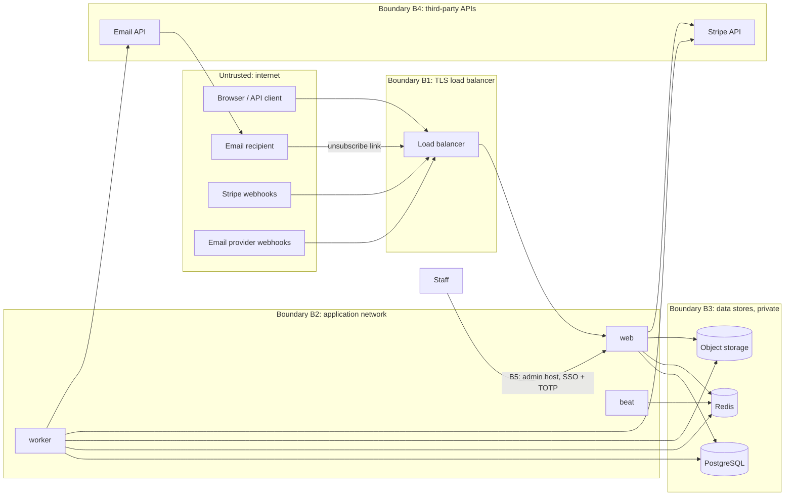

# InvoicePilot: Security Threat Model

**Version:** 1.0 · **Date:** 2026-10-20 · **Status:** Baseline for implementation and release

**Related documents:** [System design](../architecture/system-design.md) · [API contracts](../api/api-contracts.md) · [Database design](../design/phase-2.1-database-design.md)

This document lists the threats InvoicePilot must withstand, the controls that address each one, the tests that prove those controls work, and the conditions that block a release. It is reviewed whenever a feature adds a new trust boundary: a new external integration, a new upload type, team roles or API keys.

---

## 1. Scope and method

**In scope:** the Django web app (HTMX UI and the `/api/v1` JSON API), Celery workers and beat, PostgreSQL, Redis, object storage, the Stripe and email-provider integrations, the staff admin, and the CI/CD pipeline.

**Out of scope:** the security of Stripe and the email provider themselves, customers' own mailboxes, and the hosting platform's physical and hypervisor security.

**Method:** threats are found per trust boundary (§4) and classified with STRIDE (Spoofing, Tampering, Repudiation, Information disclosure, Denial of service, Elevation of privilege). Each threat is rated on two axes:

| | Low | Medium | High |
|---|---|---|---|
| **Likelihood** | Needs insider access or a rare chain of failures | Needs a plausible bug or a motivated attacker | Common, automated or trivial |
| **Impact** | A nuisance; one user; easy to undo | One workspace's data or money affected; reputational harm | Data from many workspaces exposed; financial records corrupted; the platform blocklisted |

Risk = the higher of the two, raised one level when both are High. **Inherent** risk assumes no controls. **Residual** risk assumes every control listed as required.

Every control has one of two statuses: **Exists** (in the code today, the data layer from phase 2.1) or **Required** (designed and needed before release).

## 2. Assets

| Asset | Why it matters |
|---|---|
| Tenant business data: customers, invoices, the payment ledger, reminder history | Confidential to the workspace. Errors in it cost the freelancer real money. |
| Recipient personal data: customer names and email addresses | Personal data under GDPR. Its exposure reaches people who never signed up. |
| User credentials and sessions | Lead to account takeover |
| The platform's sending reputation: the domain, IPs and provider account | Shared by every workspace. If it is blocklisted, every customer's reminders stop. |
| Subscription state | Decides write access. Forging it gives free service. |
| Secrets: `DJANGO_SECRET_KEY`, database credentials, Stripe keys, email key, webhook secrets, storage credentials | Each one unlocks one of the assets above |
| The audit log | Evidence for disputes and incident response |

## 3. Threat actors

| Actor | Capability | Typical goal |
|---|---|---|
| Anonymous internet attacker | HTTP requests, credential lists, bots | Account takeover, spam relay, scraping |
| Malicious tenant | A valid paid account. Full control of their own data, templates and CSV files. | Read other workspaces' data, use the platform to send phishing, abuse limits |
| Compromised tenant account | As above, but in a victim's workspace | Steal client lists, change payment records, send fraudulent "pay here" emails |
| Email recipient (a customer of a freelancer) | Receives emails, can click links, can report spam | Usually benign. Can suppress mail or complain. |
| Network attacker | Can observe or replay traffic outside TLS | Replay webhooks, steal tokens from logs or referrers |
| Compromised dependency or worker | Code execution inside a process | Read every workspace, send email, pivot |
| Insider (support staff, developer) | Admin access, log access, CI access | Curiosity, mistakes, or abuse |

## 4. Trust boundaries

| Boundary | What crosses it | Key controls |
|---|---|---|
| B1 Internet → app | User requests, CSV uploads, webhooks, unsubscribe clicks | TLS, authentication, CSRF, rate limits, signature checks, size limits |
| B2 App → data stores | SQL, broker messages, files | Private network, per-role credentials, tenant-scoped queries, JSON-only tasks |
| B3 Tenant → tenant (logical) | Every row in shared tables | `organization_id`, composite foreign keys, `for_organization`, 404 semantics |
| B4 App → third parties | Payment sessions, emails | Restricted and send-only keys, idempotency keys |
| B5 Staff → tenant data | Support access | Separate host, SSO, TOTP, read-only admin, audit of access |

## 5. Risk summary

| ID | Threat | STRIDE | Likelihood | Impact | Inherent | Residual |
|---|---|---|---|---|---|---|
| T1 | Broken tenant isolation | I, T | Medium | High | **Critical** | Low |
| T2 | Insecure direct object reference (IDOR) | I, T | High | High | **Critical** | Low |
| T3 | Cross-site request forgery and clickjacking | T, E | Medium | Medium | Medium | Low |
| T4 | Authentication attacks | S | High | High | **Critical** | Medium (no MFA for owners, see §11) |
| T5 | Malicious CSV files | D, T, I | Medium | Medium | Medium | Low |
| T6 | Spreadsheet formula injection | T, E | Medium | Medium | Medium | Low |
| T7 | Duplicate payments | T | High | Medium | High | Low |
| T8 | Email abuse | S, R | High | High | **Critical** | Medium |
| T9 | Webhook forgery and replay | S, T | Medium | High | High | Low |
| T10 | Secrets exposure | I, E | Medium | High | High | Low |
| T11 | Compromised worker or broker | E, I | Low | High | High | Medium |
| T12 | Unsafe logging | I | High | Medium | High | Low |

## 6. Threats

### T1. Broken tenant isolation

**Scenarios**
1. A view or selector forgets the workspace filter, for example `Invoice.objects.get(pk=id)`, and returns another workspace's invoice.
2. A background task works for workspace A but loads related rows by ID without scoping, for example a step or template belonging to workspace B.
3. A request links its own record to another workspace's row, for example creating an invoice with another workspace's `customer_id`.
4. A report, export or raw SQL aggregate leaves out `organization_id` and adds up all tenants.
5. A cache key without the workspace ID serves one workspace's dashboard to another.
6. A webhook is attributed to the wrong workspace (Stripe customer mapping).
7. The platform-wide suppression list reveals that an address bounced for another workspace.

**Controls**

| Control | Status |
|---|---|
| Every tenant row carries `organization_id NOT NULL` | Exists |
| Composite foreign keys `(organization_id, x_id)` reject cross-tenant links in PostgreSQL, whatever the writer (database design §5) | Exists (10 of 12; two are in the v2 backlog) |
| Introspection test: every tenant-to-tenant foreign key has its composite constraint | Exists |
| `TenantMiddleware` resolves the workspace from the user's `Membership` on every request, never from a parameter alone. `X-Workspace-ID` is checked against the user's memberships. | Required |
| Services take the workspace only from `ctx.organization`. Selectors start from `for_organization(ctx.organization)`. | Required |
| A Semgrep rule fails CI on `<TenantModel>.objects.get/filter/…` outside `selectors.py`, `services.py`, migrations and tests, and on any `cursor.execute` outside `selectors.py` and migrations | Required |
| `core.cache.key(ctx, *parts)` is the only way to build cache keys, and it always includes the workspace ID | Required |
| Task code builds a context from the event's workspace and loads related rows with `for_organization` | Required |
| Stripe events are matched by `stripe_customer_id`, and checkout completion is cross-checked (system design §10.1) | Required |
| Suppression listings show platform-wide entries only for the workspace's own customers' addresses (API contracts §7) | Required |
| PostgreSQL Row-Level Security as a further layer | Deferred to phase 2.4 (§11) |

**Tests:** `test_every_fk_between_tenant_tables_has_a_composite_tenant_constraint` (exists), `test_invoice_cannot_reference_a_customer_from_another_workspace` (exists), `test_cross_tenant_link_is_rejected_even_via_raw_update` (exists), `test_payment_cannot_target_another_workspaces_invoice` (exists), `test_reminder_delivery_cannot_mix_workspaces` (exists), `test_for_organization_returns_only_that_workspaces_rows` (exists), `test_cross_workspace_ids_return_404` (the endpoint matrix under T2), `test_reports_and_exports_include_only_own_workspace`, `test_planner_ignores_other_workspaces_steps_and_templates`, `test_cache_keys_include_workspace`, `test_workspace_header_must_match_membership`, `test_suppression_list_hides_unrelated_global_entries`.

### T2. Insecure direct object reference (IDOR)

**Scenarios**
1. A user changes `{id}` in `/api/v1/invoices/{id}` or `/app/invoices/{id}` to another workspace's UUID. UUIDv7 IDs are partly time-ordered, so they must not be treated as secrets.
2. A request body references a foreign object: `customer_id`, `template_id`, `reminder_policy_id`, `step_id` in a preview, or `entry_id` in a reversal.
3. A Django `ModelForm` or DRF `PrimaryKeyRelatedField` uses an **unscoped default queryset** and accepts any row's ID. This is the classic Django IDOR.
4. A response reveals that an ID exists by returning 403 instead of 404.

**Controls**

| Control | Status |
|---|---|
| Every object lookup goes through `for_organization(ctx.organization)`. A miss is 404 whether or not the row exists elsewhere. | Required |
| `core.forms.TenantModelChoiceField` and `core.api.fields.TenantPrimaryKeyRelatedField` take their queryset from `ctx` at request time. Plain `ModelChoiceField` and `PrimaryKeyRelatedField` on tenant models fail a Semgrep rule. | Required |
| Serializers list fields explicitly; `organization` and every system-owned field are read-only (mass assignment) | Required |
| Composite foreign keys reject cross-tenant links even if every layer above fails | Exists |
| Tokens in links (email verification, password reset, sender verification, unsubscribe) are signed, purpose-salted and expire, so they can't be guessed or swapped between purposes | Required |

**Tests:**
- `test_cross_workspace_ids_return_404`: walks every URL pattern with an ID parameter, in both the API and the HTML app, and every method. It creates the object in workspace B, requests it as workspace A, and expects 404 with B's row unchanged. **A new route that isn't covered makes the test fail**: the test compares its matrix with the URL resolver.
- `test_foreign_ids_in_request_bodies_are_rejected`: each body field that references an object gets another workspace's ID, and the request must fail with 404 or 400 without writing anything.
- `test_model_choice_fields_are_tenant_scoped`: renders every form and checks that each choice queryset is filtered by workspace.
- `test_signed_tokens_reject_tampering_and_purpose_swap`.

### T3. Cross-site request forgery and clickjacking

**Scenarios**
1. A malicious site makes a logged-in user's browser POST a payment reversal or turn on automation.
2. A login CSRF signs the victim into the attacker's account, so the victim types client data into it.
3. A GET request changes state, for example an unsubscribe link that a mail scanner prefetches.
4. InvoicePilot is framed by a hostile page that tricks clicks (clickjacking).
5. HTMX is tricked into requesting another origin, or into running injected script (`hx-on` or eval).

**Controls**

| Control | Status |
|---|---|
| `CsrfViewMiddleware` on every unsafe method. **Only** `/webhooks/stripe` and `/webhooks/email` are `csrf_exempt`. | Required |
| HTMX sends the token through `hx-headers` on `<body>`. API clients send `X-CSRFToken`. | Required |
| Session and CSRF cookies are `Secure`; the session cookie is `HttpOnly` and `SameSite=Lax`; `CSRF_TRUSTED_ORIGINS` is exact | Required |
| No CORS headers at all: the API is same-origin only in v1 | Required |
| GET never changes state. Unsubscribe uses a GET confirmation page and a POST action (system design §10.3). | Required |
| `X-Frame-Options: DENY` and CSP `frame-ancestors 'none'` | `XFrameOptionsMiddleware` exists. CSP is required. |
| CSP: `default-src 'self'; script-src 'self'; style-src 'self'; img-src 'self' data:; connect-src 'self'; form-action 'self'; frame-ancestors 'none'; base-uri 'none'; object-src 'none'`. No inline scripts and no `hx-on`. | Required |
| HTMX config: `selfRequestsOnly`, `allowEval=false`, `allowScriptTags=false`. HTMX is vendored at a pinned version with a checksum test. | Required |
| Post-login redirects (`next`) are checked with `url_has_allowed_host_and_scheme` | Required |

**Tests:** `test_only_webhook_views_are_csrf_exempt` (walks the resolver), `test_unsafe_methods_without_csrf_token_are_rejected` (uses `Client(enforce_csrf_checks=True)` against every POST, PATCH and DELETE route), `test_security_headers_present` (CSP, XFO, HSTS, `nosniff`, `Referrer-Policy: same-origin`), `test_no_cors_headers_on_api`, `test_unsubscribe_get_does_not_unsubscribe`, `test_login_redirect_rejects_external_next`, `test_vendored_htmx_checksum`.

### T4. Authentication attacks

**Scenarios:** credential stuffing and brute force; account enumeration through sign-up, login or reset responses or their timing; session fixation or hijacking; password-reset poisoning through a forged `Host` header; reset tokens leaking through the `Referer` header or access logs; weak passwords; email-verification bypass; taking over an account by changing its email; old sessions surviving a password change; staff account takeover.

**Controls**

| Control | Status |
|---|---|
| Passwords hashed with Argon2id (`PASSWORD_HASHERS` puts Argon2 first, with PBKDF2 kept for upgrade on login) | Required (PBKDF2 exists) |
| Validators: minimum 12 characters, common-password list, similarity, not all digits. Recommended: a breached-password check through the HIBP k-anonymity API, failing open. | Required |
| Login throttling in Redis: 5 failures per account per 15 minutes means a 15-minute wait; 30 attempts per IP per 10 minutes; sign-ups limited to 5 per IP per hour | Required |
| Identical responses for "no such account" and "wrong password"; for sign-up with an existing email ("check your inbox", and the owner gets a notice); and for reset requests. Django's `ModelBackend` already runs the hasher for unknown users, to equalize timing. | Required |
| The session key is rotated on login (Django default). `SESSION_COOKIE_AGE` is 14 days. A password change or reset invalidates other sessions (session auth hash). There is a "sign out everywhere" action. | Required |
| `ALLOWED_HOSTS` is exact. Reset and verification emails build links from `settings.SITE_URL`, never from the request host. | Required |
| `PASSWORD_RESET_TIMEOUT = 3600` (1 hour). Django's confirm view moves the token into the session at once. `Referrer-Policy: same-origin`. Token routes are logged by route name only (T12). | Required |
| Email-verification tokens are signed, expire after 48 hours, and are bound to the current email value, so changing the email voids them | Required |
| Changing the email needs the current password and verification of the new address, and notifies the old address | Required |
| Staff: separate admin host, SSO or IP allow-list, mandatory TOTP | Required |
| Workspace owners: optional TOTP | v1.1 (accepted risk, §11) |

**Tests:** `test_login_throttled_after_failed_attempts`, `test_login_signup_and_reset_do_not_reveal_accounts`, `test_session_rotated_on_login`, `test_password_change_invalidates_other_sessions`, `test_password_reset_link_uses_configured_site_url`, `test_reset_token_expires_after_one_hour`, `test_verification_token_void_after_email_change`, `test_email_change_requires_password_and_reverification`, `test_admin_requires_staff_and_otp`, `test_user_email_is_unique_ignoring_case` (exists).

### T5. Malicious CSV files

**Scenarios:** an oversized file or row exhausting memory or CPU; a huge quoted field; millions of rows; invalid UTF-8, NUL bytes or mixed newlines crashing the parser; a binary file (ZIP, XLSX, PDF) renamed `.csv`; a filename such as `../../etc/x` or `<script>` used as a path or rendered as HTML; cell values carrying HTML or script that later appear in the preview or the UI (stored XSS); an import used to create thousands of customers past the plan limit, or to overwrite existing customers' details; formula payloads (T6).

**Controls**

| Control | Status |
|---|---|
| The upload is capped at 5 MB by the load balancer (6 MB body limit), by Django (`DATA_UPLOAD_MAX_MEMORY_SIZE`) and by an explicit size check. It is streamed to object storage, never written to local disk. | Required |
| Stored under a random key (`imports/<org>/<uuid>`). The original filename is kept only as display text, always escaped, and never used in a path or header. | Required |
| Content check: the first bytes must not match ZIP, PDF or OLE signatures. Decoded strictly as UTF-8 (BOM allowed); a decode error rejects the file with a clear message. | Required |
| Parsed in the worker with the standard library `csv` module (no pandas, no spreadsheet libraries): `csv.field_size_limit(10_000)`, at most 5,000 rows, 30 columns and 1 MB per line. A NUL byte rejects the file. Soft time limit 60 s, after which the batch is `failed`. | Required |
| Values are validated per column (dates, decimals, email) before any database write. The preview renders every value through Django's autoescaping; `|safe` and `mark_safe` on user data fail a Semgrep rule. | Required |
| An import **never modifies** existing customers. It only matches them by email, or creates new ones. | Required |
| Plan limits are checked at commit, under the workspace advisory lock | Required |
| Raw files and row data are purged after 30 days | Exists |

**Tests:** `test_import_rejects_oversized_file`, `test_import_rejects_too_many_rows_columns_and_long_fields`, `test_import_rejects_binary_nul_and_invalid_utf8`, `test_import_filename_is_never_used_as_a_path`, `test_import_preview_escapes_cell_html`, `test_import_never_modifies_existing_customers`, `test_import_commit_respects_plan_limits`, `test_import_parser_fuzz` (Hypothesis: random bytes and rows never raise outside the parser's error type, and never take more than a second), `test_import_files_and_rows_are_purged_after_retention` (exists).

### T6. Spreadsheet formula injection

**Scenario:** a text value that starts with `=`, `+`, `-`, `@`, a tab or a carriage return is exported to CSV and opened in Excel, LibreOffice or Google Sheets. It runs as a formula: data leaks through `HYPERLINK` or `WEBSERVICE`, or older clients run DDE payloads. The values come from imported third-party CSVs, from text a client supplied that the freelancer pasted in, or later from team members. Every text column can carry one: customer name, company, email, invoice number, description, notes, payment reference and reason fields.

**Controls**

| Control | Status |
|---|---|
| Values are stored exactly as entered. Escaping happens on output, so the data stays faithful. | Required |
| `core.csv.SafeCsvWriter` declares a type for each column. **Text** cells starting with `=`, `+`, `-`, `@`, `\t` or `\r` are prefixed with `'`. Every cell is quoted (`QUOTE_ALL`). **Money and number** cells are written by the writer from `Decimal` and never escaped, so `-600.00` stays a number. | Required |
| Every CSV the product produces (exports, the import template, any error report) goes through `SafeCsvWriter`. A Semgrep rule forbids `csv.writer` elsewhere. | Required |
| Exports are downloads (`Content-Disposition: attachment`, `text/csv`) and are never rendered inline | Required |

**Tests:** `test_exports_neutralize_formula_prefixes` (each prefix, including after a leading quote), `test_exports_keep_negative_amounts_numeric`, `test_all_csv_output_uses_safe_writer`, `test_export_round_trip_preserves_values` (re-importing an export gives the original strings back, minus the guard prefix).

### T7. Duplicate payments

**Scenarios:** a double-clicked "Record payment"; a client retrying after a timeout; two tabs; two requests racing on the same invoice; the same CSV committed twice, or the same file uploaded twice with `amount_paid` columns; someone "fixing" a payment by recording a second one; a second Stripe checkout creating two subscriptions.

**Impact:** a wrong balance. The invoice looks paid, so reminders stop and the freelancer loses money, or reminders go out for money already paid.

**Controls**

| Control | Status |
|---|---|
| An `idempotency_key` on every ledger entry, UNIQUE per workspace. Forms embed one per rendered form; the API requires `Idempotency-Key`. | Required (database v2 backlog) |
| The invoice row is locked `FOR NO KEY UPDATE` around every ledger write, so concurrent payments serialize | Required |
| The CHECK `0 ≤ balance_due ≤ total_amount` makes overpayment impossible whatever the code does | Exists |
| **Possible-duplicate guard:** an entry with the same invoice, kind, amount and `received_on` as one recorded in the previous 10 minutes, under a different key, returns `409 possible_duplicate` with `existing_id`. The client must resend with `"confirm_duplicate": true`. | Required |
| The ledger is append-only and corrections are reversals, so every change is visible and audited | Required (database v2) |
| Import commit is a compare-and-set (`validated → committing`). Duplicate invoice numbers are skipped, so their `amount_paid` is never applied twice. A file whose hash matches an earlier import shows a warning. | Exists (hash index), required (logic) |
| Nightly balance reconciliation | Required |
| Stripe: one live subscription per workspace (partial UNIQUE), checkout refused while one is live, idempotency keys on Customer and Checkout creation | Exists (constraint), required (logic) |

**Tests:** `test_double_submit_with_same_key_records_once`, `test_same_key_different_body_is_rejected`, `test_concurrent_payments_cannot_overpay` (two database connections), `test_possible_duplicate_requires_confirmation`, `test_import_commit_twice_creates_nothing_new`, `test_reimported_file_does_not_reapply_payments`, `test_second_checkout_blocked_while_subscription_live`, `test_overpayment_is_refused` (exists), `test_one_live_subscription_per_workspace` (exists).

### T8. Email abuse

**Scenarios**
1. **Phishing or spam relay:** an attacker subscribes, imports thousands of addresses as "customers", and sends "overdue invoice, pay here" emails with a malicious link from InvoicePilot's trusted domain.
2. **Display-name spoofing:** `from_name` set to `PayPal Billing <service@paypal.com>`.
3. **Header injection:** CR or LF in the subject or `from_name` adds `Bcc:` headers.
4. **Template injection (SSTI):** `{{ settings.SECRET_KEY }}` or `` in a template.
5. **Mailbombing through verification emails:** sign-ups or sender identities using a victim's address, then repeated resends.
6. **Sabotage through suppressions:** forged complaints or bounces silence a competitor's reminders (see T9).
7. **Reputation collapse:** complaints from one workspace get the shared domain blocklisted, which stops every customer's reminders.
8. **Unsubscribe-token forgery** to unsubscribe arbitrary recipients.

**Controls**

| Control | Status |
|---|---|
| **A paid subscription is needed to send** (D3). Stripe's fraud screening covers checkout. There is no free tier to abuse. | Exists (access model) |
| Sending needs a verified user email **and** a verified sender identity. Reply-To must be an address the user has proved they control. | Required |
| From address: always `"<from_name> via InvoicePilot" <reminders@mail.invoicepilot.app>`. `from_name` rejects `@ < > "` and line breaks. | Required |
| Subject, `from_name` and template subject reject CR and LF at save. The Python `email` package also refuses header newlines when sending. | Required |
| Templates are plain text with **placeholder substitution only** (`{{name}}` from an allow-list, done with a regex). No template engine ever sees user text. Unknown placeholders are rejected at save. | Required |
| Recipients are only the email addresses of the workspace's customers. There is no free-form "send to" field. | Required |
| Volume limits: the plan's monthly limit; **200 per hour** per workspace; **50 per day for a workspace's first 14 days**; a hard daily cap at the provider account | Required |
| **Automatic suspension:** 3 or more complaints in 7 days, or a hard-bounce rate above 10% with at least 20 sends in 7 days, sets `sending_suspended_at` (system design S2). Deliveries skip with `sending_suspended`, the owner is told, and staff review it. | Required |
| Hard bounces and complaints suppress the address platform-wide. Only staff can lift them. | Exists (schema) |
| Every reminder has a footer naming the workspace ("Sent by Reyes Studio via InvoicePilot"), a report-abuse link, `List-Unsubscribe` and one-click `List-Unsubscribe-Post` (RFC 8058) | Required |
| Unsubscribe tokens are signed with a purpose salt and bound to workspace and address. Unsubscribe is per workspace. | Required |
| Verification and transactional mail: 3 resends per hour per identity, 10 sender verifications per workspace per day, sign-up limits per IP (T4) | Required |
| Separate subdomains for reminders (`mail.`) and account mail (`notify.`), so reminder complaints can't block password resets. SPF, DKIM and DMARC aligned. | Required |
| Open and click tracking off (privacy, and no tracking redirects that could be abused) | Required |

**Tests:** `test_from_name_rejects_address_characters`, `test_headers_reject_line_breaks`, `test_template_rejects_unknown_placeholders`, `test_template_rendering_never_evaluates_template_syntax`, `test_reminders_only_go_to_customer_addresses`, `test_sending_caps_for_new_workspaces`, `test_hourly_workspace_cap`, `test_complaints_suspend_workspace_sending`, `test_suspended_workspace_deliveries_are_skipped`, `test_unsubscribe_token_is_signed_and_scoped`, `test_reminder_has_list_unsubscribe_headers_and_footer`, `test_sender_verification_resend_is_rate_limited`, `test_suppression_scope_and_lookup` (exists).

### T9. Webhook forgery and replay

**Scenarios:** a forged `customer.subscription.updated` (`status: active`) to get free write access; a replayed, captured, valid event; an old event delivered late that downgrades or upgrades state (Stripe doesn't guarantee order); a test-mode event sent to the live endpoint; a forged email-provider bounce or complaint that suppresses a competitor's customers or suspends their sending; a flood of large bodies at the webhook URL; a timing attack on a non-constant-time signature comparison.

**Controls**

| Control | Status |
|---|---|
| Stripe signatures checked with `construct_event` over the **raw body** with a 300-second tolerance. Email-provider HMAC checked with `hmac.compare_digest` and a 5-minute timestamp window. | Required |
| Unverified requests return 400 and are **never stored**. Only the event ID and the failure reason are logged. | Required |
| Inbox `UNIQUE (provider, external_id)` with `INSERT … ON CONFLICT DO NOTHING`, so a replay is a no-op that still returns 200 | Exists (constraint) |
| Ordering: subscription state is retrieved fresh from the Stripe API and applied only if newer than `stripe_event_created`, under a row lock | Exists (column), required (logic) |
| `livemode` must match the environment. Separate secrets per environment. | Required |
| Checkout completion requires `client_reference_id` and the session's `customer` to agree with the stored mapping | Required |
| Email events act only on a `provider_message_id` InvoicePilot sent. Unknown IDs are ignored. | Required |
| Body cap of 1 MB. Signature checking is cheap and runs before any database work. Edge rate limit per source IP. | Required |
| Two secrets accepted during rotation (§8) | Required |

**Tests:** `test_unsigned_or_badly_signed_webhooks_are_rejected_and_not_stored`, `test_stale_signature_timestamp_rejected`, `test_replayed_webhook_is_rejected` (exists, database level), `test_replayed_webhook_request_returns_200_without_reprocessing`, `test_out_of_order_subscription_events_do_not_roll_back`, `test_livemode_mismatch_ignored`, `test_checkout_session_customer_must_match_workspace`, `test_email_event_for_unknown_message_is_ignored`, `test_webhook_secret_rotation_accepts_both`.

### T10. Secrets exposure

**Scenarios:** a secret committed to git (`.env`, a test fixture, a notebook); `DEBUG=True` in production showing settings on an error page; secrets in logs, Sentry events or CI output; secrets baked into image layers; one Stripe or email key shared between staging and production; an over-privileged key leaked; a production database dump restored into a less-protected environment; `DJANGO_SECRET_KEY` leaked, which lets an attacker forge password-reset, verification and unsubscribe tokens.

**Controls**

| Control | Status |
|---|---|
| Settings fail to start without `DJANGO_SECRET_KEY` when `DEBUG` is off. `DEBUG` defaults to off. | Exists |
| Every secret comes from the platform's secret store as an environment variable; none are written in the image or the repo. `.env` is git-ignored. | Exists (`.gitignore`), required (store) |
| `gitleaks` in pre-commit and CI. GitHub secret scanning and push protection on. | Required |
| Separate secrets per environment. Staging uses Stripe test mode and an email sandbox. | Required |
| Least privilege: Stripe **restricted** keys (web: Customers, Checkout and Portal write, Subscriptions read; worker: read only); email key send-and-lookup only, held **only by the worker**; storage credentials for one bucket; database roles per system design §12.3 | Required |
| `manage.py check --deploy` passes in CI. Custom 500 page with no details. | Required |
| Log redaction and Sentry scrubbing (T12) | Required |
| Production data never leaves production. Restore drills run in an isolated, temporary environment that is destroyed afterwards. | Required |
| Rotation runbook (§8) | Required |

**Tests and checks:** `test_settings_refuse_to_start_without_secrets_in_production`, `test_debug_off_by_default`, `test_error_pages_do_not_leak_details`, `test_stripe_and_email_keys_are_not_in_web_settings` (each process type loads only the secrets it needs), plus CI gates: gitleaks, `check --deploy`, and an image scan (Trivy) with no high or critical findings.

### T11. Compromised worker or broker

**Scenarios:** remote code execution in a worker (a vulnerable dependency, a parser bug, unsafe deserialization); an attacker with access to Redis injecting Celery messages (send now, re-run a commit, a reminder for another workspace); a worker leaking its credentials.

**Impact:** workers hold the application database role, which can read every workspace, plus the email key. This is the largest blast radius in the system.

**Controls**

| Control | Status |
|---|---|
| Celery accepts **JSON only** (no pickle, so injected messages can't execute code) | Required |
| Redis on the private network, with a password and TLS. No public endpoint. | Required |
| **Tasks take IDs only and revalidate everything** against PostgreSQL: `send_delivery` checks the state, `scheduled_for <= now()`, eligibility and caps, so an injected task can do no more than a legitimate due job would. `commit_batch` relies on its compare-and-set. | Required |
| The application database role has no DDL, and **no UPDATE or DELETE on the ledger and audit tables**, so history can't be rewritten even with stolen credentials | Required (phase 2.4); triggers exist for audit, required for ledger |
| Split credentials: web holds the Stripe write key and no email key; the worker holds the email key and a read-only Stripe key | Required |
| Daily sending cap configured at the email provider, which the app can't override | Required |
| Containers run as non-root with a read-only root filesystem and no inbound ports on workers. Egress allow-list (database, Redis, storage, Stripe, email API, Sentry) where the platform supports it. | Required (egress where available) |
| Locked dependencies with hashes (`uv.lock`), `pip-audit` in CI, Dependabot. CSV parsing uses only the standard library. | Exists (lockfile), required (rest) |
| Detection: sending-volume and queue-depth alerts, audit-event anomalies, Sentry | Required |

**Response:** rotate every worker secret (§8), redeploy from a clean image, review the audit log, the outbox and delivery history for the exposure window, and notify affected workspaces where personal data was accessed (GDPR Article 33: within 72 hours).

**Tests:** `test_celery_accepts_json_only`, `test_send_delivery_rechecks_eligibility_when_invoked_directly` (an "injected" task for a delivery that isn't due or isn't eligible sends nothing), `test_commit_batch_task_is_idempotent`, `test_app_role_cannot_modify_ledger_or_audit` (phase 2.4), `test_audit_events_are_append_only` (exists).

### T12. Unsafe logging

**Scenarios:** passwords, session cookies, `Authorization` or `Stripe-Signature` headers, or API keys in logs or exceptions; reset, verification and unsubscribe tokens in access-log URLs; customer emails, names, amounts, email bodies, CSV rows or webhook payloads written to logs that are kept longer and seen by more people than the database; SQL parameters in Sentry breadcrumbs; CR and LF in user input forging log lines.

**Controls**

| Control | Status |
|---|---|
| One JSON object per line (CR and LF are escaped, so lines can't be forged). Fields come from an allow-list: IDs, route name, status, duration, counts and error codes. | Required |
| `core.logging.RedactingFilter` masks keys matching `password|token|secret|authorization|cookie|signature|api_key|session|csrf` and values matching key formats (`sk_live_`, `rk_live_`, `whsec_`, `Bearer `) | Required |
| The access-log line is written by `RequestIdMiddleware` using the **route name**, not the raw path or query string. Gunicorn's own access log is off. | Required |
| Personal data is not logged. When an address must be correlated, log `email_hash` (HMAC-SHA256 with a logging pepper, first 16 hex characters). | Required |
| Webhook payloads, email bodies and CSV contents are never logged. They live in their tables with retention limits. | Required |
| Sentry: `send_default_pii=False`; `before_send` drops request bodies, cookies and all headers except an allow-list; SQL breadcrumbs without parameters | Required |
| Celery task arguments are IDs only, so task logs carry nothing sensitive | Required |
| Logs kept 30 days; access limited to on-call engineers | Required |
| The audit log, not application logs, is the record of who did what | Exists |

**Tests:** `test_redaction_filter_masks_sensitive_keys_and_values`, `test_token_routes_are_logged_by_route_name`, `test_sentry_before_send_strips_bodies_cookies_and_headers`, `test_webhook_failure_logs_exclude_payload`, `test_log_lines_are_single_line_json`, `test_no_email_addresses_in_log_output` (captures logs from a full request and task cycle and searches them for the test addresses).

## 7. Other threats considered

| Threat | Control |
|---|---|
| Stored or reflected XSS | Django autoescaping. A Semgrep rule bans `|safe`, `mark_safe` and `format_html` on user data. Strict CSP with no inline script (T3). HTMX inserts server-escaped HTML only. |
| SQL injection | The ORM everywhere. Raw SQL only in selectors and migrations, with parameters. A Semgrep rule bans string formatting in `execute`. |
| Server-side request forgery (SSRF) | The server never fetches a URL supplied by a user. Outbound hosts are fixed (Stripe, the email API, storage). |
| Mass assignment | Serializers and forms list their fields explicitly. System-owned fields are read-only (T2). |
| Open redirect | `next` is validated (T3). `HX-Redirect` uses relative paths only. |
| Privilege escalation through the admin | Separate host, SSO or allow-list, TOTP, read-only tenant models, `admin.support_access` audit (system design §12.4) |
| Denial of service | Gunicorn timeouts, body limits, rate limits, `statement_timeout`, cursor pagination, upload and parse limits (T5) |
| Supply chain | Locked dependencies with hashes, `pip-audit`, Dependabot, vendored HTMX with a checksum, CI with pinned action SHAs |
| Repudiation | Append-only audit log for money, state and access events. Reversals keep the original entry visible. |
| Insider misuse of support access | Audit of support access, visible to the owner (API contracts §11). Read-only database role for support queries, with logged connections. |

## 8. Secret rotation runbook

| Secret | Planned rotation | After a suspected leak |
|---|---|---|
| `DJANGO_SECRET_KEY` | Yearly. Put the old key in `SECRET_KEY_FALLBACKS` for 14 days, then remove it. | Rotate **without** a fallback: every reset, verification and unsubscribe token becomes invalid (accepted cost). Database sessions survive, because they aren't signed with the key. Force a password reset if there are signs of account takeover. |
| Database passwords (app, migrator) | Every 6 months, through the provider's dual-credential support | Rotate at once and check `pg_stat_activity` and the logs for unknown clients |
| `STRIPE_SECRET_KEY` (restricted) | Yearly: roll in the Stripe dashboard with an expiry on the old key | Roll with immediate expiry. Review Stripe's API logs. |
| `STRIPE_WEBHOOK_SECRETS` | Yearly: add the new secret to the list, switch the endpoint, then remove the old one | Same, quickly. Replay protection still holds. |
| Email API key and webhook secret | Yearly | Revoke, review the provider's send logs, check suppression changes |
| Storage credentials | Yearly | Rotate and review bucket access logs |
| Redis password | Yearly | Rotate and restart every process |
| Logging pepper (`LOG_HASH_PEPPER`) | Not rotated: rotating breaks correlation | Rotate. Old hashes become uncorrelatable, which is acceptable. |

Every rotation writes a `security.secret_rotated` audit event with the secret's name, never its value.

## 9. Security test plan

| Layer | What | Gate |
|---|---|---|
| Unit and integration tests (`pytest -m security`) | Every test named in §6, against PostgreSQL 17 | **CI-blocking** |
| Endpoint matrices | `test_cross_workspace_ids_return_404`, `test_unsafe_methods_without_csrf_token_are_rejected`, `test_read_only_workspace_blocks_writes`, plus the coverage check against the URL resolver | **CI-blocking** |
| Static analysis | `ruff` (with `S` rules), Semgrep custom rules (T1, T2, T5, T6, XSS, SQL), `lint-imports` | **CI-blocking** |
| Dependencies and secrets | `pip-audit` (no high or critical), `gitleaks`, Trivy image scan | **CI-blocking** |
| Configuration | `manage.py check --deploy` with production settings | **CI-blocking** |
| Dynamic scan | OWASP ZAP baseline against staging | Weekly, plus before each release. New high findings block the release. |
| Email deliverability | SPF, DKIM and DMARC alignment checked with a seed mailbox. `List-Unsubscribe` one-click works in Gmail and Outlook. | Before general availability, then quarterly |
| Manual review | A two-person review of every change to `TenantMiddleware`, `permissions`, `core.api.fields`, webhook views and the ledger services (enforced through CODEOWNERS) | Every pull request touching those paths |
| External penetration test | Scoped to T1, T2, T4 and T8 | Recommended before scaling past the pilot. Not release-blocking today (§11). |

## 10. Release-blocking issues

**Policy:** any open finding rated **High or Critical**, from any source (tests, scans, review, external report), blocks a release. Medium findings need an owner and a fix date within 30 days. Low findings are tracked.

**Conditions for general availability.** Every one must be met. Status as of this document: only the data layer exists.

| ID | Condition | Verified by | Status |
|---|---|---|---|
| RB-01 | Composite tenant foreign keys exist for every tenant-to-tenant link, including the two v2 additions | `test_every_fk_between_tenant_tables_…` | Partly met (10 of 12) |
| RB-02 | The cross-workspace 404 matrix covers 100% of ID routes in the API and HTML app, and passes | `test_cross_workspace_ids_return_404` + coverage check | Open |
| RB-03 | No unscoped model choice fields or related fields; the Semgrep tenant rules pass | `test_model_choice_fields_are_tenant_scoped`, Semgrep | Open |
| RB-04 | CSRF is enforced on every unsafe route; only the two webhook views are exempt | `test_only_webhook_views_are_csrf_exempt`, `test_unsafe_methods_…` | Open |
| RB-05 | Security headers and CSP are present; `check --deploy` is clean; `DEBUG` is off | `test_security_headers_present`, CI | Open |
| RB-06 | Login throttling, responses that don't reveal accounts, 1-hour reset tokens, session invalidation on password change | T4 tests | Open |
| RB-07 | Staff admin on a separate host with mandatory TOTP | `test_admin_requires_staff_and_otp`, deployment review | Open |
| RB-08 | CSV upload and parsing limits are enforced; the fuzz test passes | T5 tests | Open |
| RB-09 | Every CSV output goes through `SafeCsvWriter` | T6 tests, Semgrep | Open |
| RB-10 | Ledger idempotency, concurrency and possible-duplicate tests pass; the ledger is append-only | T7 tests | Open (database v2 backlog) |
| RB-11 | Sending controls work: verified sender, caps, automatic suspension, one-click unsubscribe, header and placeholder validation; SPF, DKIM and DMARC aligned | T8 tests, seed-mailbox check | Open |
| RB-12 | Webhook signature, replay, ordering and livemode tests pass; unverified requests are not stored | T9 tests | Partly met (replay constraint) |
| RB-13 | No secrets in the repo or image; per-environment, least-privilege keys; rotation runbook rehearsed once | gitleaks, Trivy, a rotation drill | Open |
| RB-14 | Celery is JSON-only; Redis is private with auth and TLS; tasks revalidate state | T11 tests, infrastructure review | Open |
| RB-15 | Log redaction, route-name access logs and Sentry scrubbing are in place; no addresses in log output | T12 tests | Open |
| RB-16 | No high or critical vulnerabilities in dependencies or the image | `pip-audit`, Trivy | Open |
| RB-17 | A backup restore drill has been completed, including the delivery reconciliation step | System design §12.5 | Open |
| RB-18 | Audit events exist for logins, payments, reversals, exports, settings changes, automation toggles and support access | `test_sensitive_actions_write_audit_events` | Partly met (append-only table) |

## 11. Accepted risks

These risks are known and accepted for launch. Each needs the product owner's sign-off and is reviewed when its trigger occurs.

| Risk | Why it's accepted | Revisit when |
|---|---|---|
| No MFA for workspace owners at launch (T4) | Strong password policy, throttling and session controls reduce the risk. MFA adds onboarding friction for the pilot. | v1.1, or the first account-takeover report |
| No PostgreSQL RLS (T1) | Four other layers, including database-enforced composite foreign keys. RLS needs pooling-safe tenant context. | Phase 2.4, or before team roles |
| A reminder can carry a stale balance if a payment lands during the few seconds of the send (database design §11.4) | Closing the window would mean holding locks across network calls. The email wording covers it. | Complaints about it |
| One shared sending domain for all workspaces (T8) | Per-tenant custom domains are complex for the MVP. Caps, automatic suspension and platform-wide suppression limit the damage. | More than 200 workspaces, or the first blocklisting |
| No external penetration test before general availability | Budget. The CI-blocking matrices cover the highest risks (T1, T2). | Before scaling past the pilot, or the first enterprise customer |
| Formula injection by a tenant against themselves (T6) | Escaping on output neutralizes it. Malicious input from a team member only becomes relevant when roles exist. | Team roles |

## 12. Changes this requires in other documents

| Change | Where |
|---|---|
| `Organization.sending_suspended_at` and `sending_suspended_reason`, plus skip reason `sending_suspended` (T8) | Database design §15, backlog item 13 |
| Skip reason `too_late` for deliveries more than 24 hours late | Database design §15, backlog item 12 |
| The `409 possible_duplicate` response and the `confirm_duplicate` field (T7) | API contracts §1.6 and §6 |
| Database role privileges for the ledger and audit tables (T11) | Phase 2.4 |
